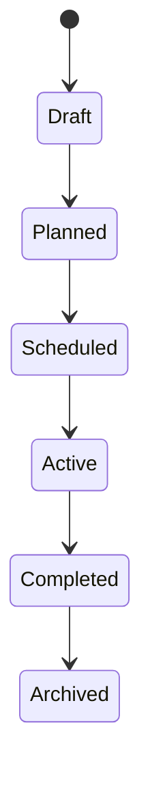
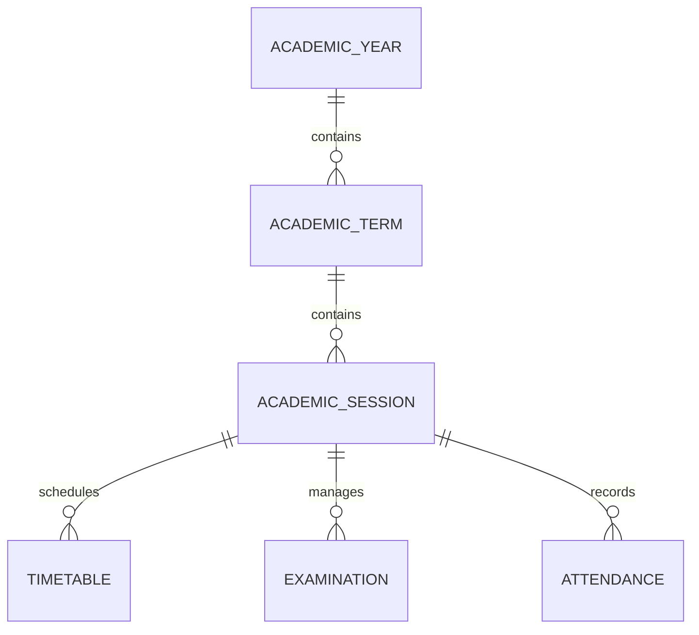

# Nexus School

# Academic Session Specification

---

| Property | Value |
|----------|-------|
| Domain | Academic |
| Module | Academic Management |
| Entity | AcademicSession |
| Table | academic_sessions |
| Primary Key | UUID |
| Version | 1.0.0 |
| Status | Approved |
| Owner | Nexus Technologies |
| Last Updated | 2026-07-02 |

---

# Table of Contents

1. Purpose
2. Business Definition
3. Business Objectives
4. Scope
5. Dependencies
6. Lifecycle
7. State Machine
8. Core Attributes
9. Relationships
10. Business Rules
11. Validation Rules
12. Permissions
13. Business Events
14. Notifications
15. Audit Requirements
16. API Mapping
17. Filament Resource
18. Database Mapping
19. Eloquent Relationships
20. Performance
21. Edge Cases
22. Future Enhancements
23. Related Documents
24. Summary

---

# 1. Purpose

The Academic Session represents the smallest official instructional period within an Academic Term.

It is used to organize teaching activities, attendance, assessments, examinations, grading periods, and reporting windows.

Academic Sessions provide flexibility for institutions operating with semesters, trimesters, blocks, quarters, or custom instructional calendars.

---

# 2. Business Definition

An Academic Session is a scheduled instructional period belonging to one Academic Term.

Examples include:

- Session A
- Session B
- Block 1
- Block 2
- Clinical Rotation
- Laboratory Session
- Internship Period

Each institution may define its own session structure according to its educational policies.

---

# 3. Business Objectives

The Academic Session enables the institution to:

- Divide Academic Terms into operational periods.
- Schedule teaching activities.
- Organize attendance tracking.
- Schedule examinations.
- Control grading periods.
- Generate session-based reports.
- Improve academic planning.

---

# 4. Scope

Academic Session impacts:

- Teaching
- Attendance
- Timetable
- Examination
- Assessment
- Grading
- Report Cards
- Analytics

---

# 5. Dependencies

## Depends On

- AcademicYear
- AcademicTerm

## Used By

- Attendance
- Examination
- Timetable
- Report Cards
- Academic Analytics
- AI Academic Assistant

---

# 6. Lifecycle

Academic Sessions follow this lifecycle:

Draft

↓

Planned

↓

Scheduled

↓

Active

↓

Completed

↓

Archived

Only one Academic Session may be active within the same schedule unless institutional policies explicitly allow concurrent sessions.

---

# 7. State Machine



---

# 8. Core Attributes

| Attribute | Type | Required |
|------------|------|----------|
| UUID | UUID | Yes |
| Academic Year ID | UUID | Yes |
| Academic Term ID | UUID | Yes |
| Name | String | Yes |
| Code | String | Yes |
| Description | Text | No |
| Start Date | Date | Yes |
| End Date | Date | Yes |
| Status | Enum | Yes |
| Sort Order | Integer | Yes |
| Is Current | Boolean | Yes |
| Created By | UUID | Yes |
| Updated By | UUID | Yes |
| Created At | Timestamp | Yes |
| Updated At | Timestamp | Yes |
| Deleted At | Timestamp | No |

---

# 9. Relationships



---

# 10. Business Rules

### AS-001

Every Academic Session belongs to one Academic Term.

### AS-002

Every Academic Session belongs indirectly to one Academic Year.

### AS-003

Academic Sessions cannot overlap within the same Academic Term.

### AS-004

The Start Date must be earlier than the End Date.

### AS-005

Attendance cannot be recorded outside an active Academic Session.

### AS-006

Timetables cannot reference inactive Academic Sessions.

### AS-007

Completed Academic Sessions become read-only.

### AS-008

Archived Academic Sessions cannot be modified.

---

# 11. Validation Rules

The system validates:

- Name uniqueness inside one Academic Term.
- Code uniqueness.
- Date consistency.
- Valid Academic Year.
- Valid Academic Term.
- No overlapping sessions.
- Valid status transitions.

---

# 12. Permissions

| Permission | Description |
|------------|-------------|
| academic_session.view | View Academic Sessions |
| academic_session.create | Create Sessions |
| academic_session.update | Edit Sessions |
| academic_session.delete | Delete Sessions |
| academic_session.activate | Activate Session |
| academic_session.archive | Archive Session |

---

# 13. Business Events

The following domain events are emitted:

- AcademicSessionCreated
- AcademicSessionUpdated
- AcademicSessionActivated
- AcademicSessionCompleted
- AcademicSessionArchived

---

# 14. Notifications

Notifications may be sent for:

- Session opening
- Session closing
- Assessment period
- Examination schedule
- Grading deadline

---

# 15. Audit Requirements

Every modification records:

- User
- Timestamp
- Tenant
- Previous Values
- New Values
- IP Address
- Device Information

---

# 16. API Mapping

| Method | Endpoint |
|---------|----------|
| GET | /api/v1/academic-sessions |
| GET | /api/v1/academic-sessions/{id} |
| POST | /api/v1/academic-sessions |
| PUT | /api/v1/academic-sessions/{id} |
| DELETE | /api/v1/academic-sessions/{id} |
| POST | /api/v1/academic-sessions/{id}/activate |
| POST | /api/v1/academic-sessions/{id}/archive |

---

# 17. Filament Resource

The AcademicSessionResource provides:

- List Records
- View Record
- Create Record
- Edit Record

Custom Actions:

- Activate
- Archive
- Duplicate Session

---

# 18. Database Mapping

Primary Table:

```
academic_sessions
```

Indexes:

- academic_year_id
- academic_term_id
- status
- start_date
- end_date

Foreign Keys:

- academic_year_id → academic_years.id
- academic_term_id → academic_terms.id

---

# 19. Planned Eloquent Relationships

AcademicSession

- belongsTo(AcademicYear)
- belongsTo(AcademicTerm)
- hasMany(Timetable)
- hasMany(Examination)
- hasMany(Attendance)

---

# 20. Performance

Recommended indexes:

- Current Session
- Active Session
- Academic Year
- Academic Term
- Status

Frequently accessed records should be cached.

---

# 21. Edge Cases

Examples include:

- Overlapping sessions.
- Multiple active sessions.
- Editing completed sessions.
- Deleting sessions with attendance.
- Deleting sessions with examinations.
- Changing dates after grading begins.

---

# 22. Future Enhancements

Possible future improvements:

- AI schedule optimization.
- Calendar synchronization.
- National holiday integration.
- Automatic session rollover.
- Predictive academic analytics.

---

# 23. Related Documents

- AcademicYear.md
- AcademicTerm.md
- 03_Business_Rules.md
- 07_API.md
- 09_ERD.md

---

# 24. Summary

Academic Sessions represent the operational academic periods used to organize teaching, attendance, examinations, grading, reporting, and analytics throughout the Academic Term.

---

**End of Document**