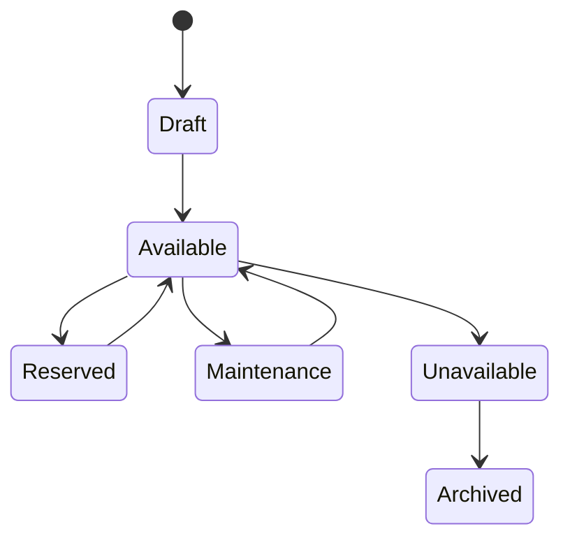
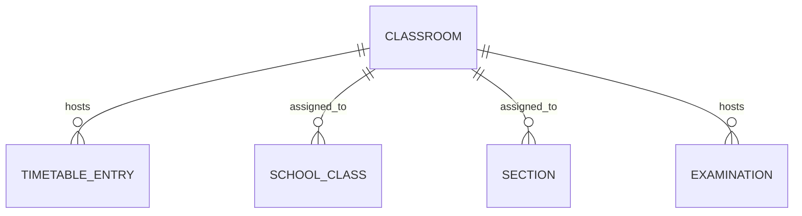

# Nexus School

# Classroom Specification

---

| Property | Value |
|----------|-------|
| Domain | Academic |
| Module | Academic Management |
| Entity | Classroom |
| Table | classrooms |
| Primary Key | UUID |
| Version | 1.0.0 |
| Status | Approved |
| Owner | Nexus Technologies |
| Last Updated | 2026-07-03 |

---

# Table of Contents

1. Purpose
2. Business Definition
3. Business Objectives
4. Scope
5. Dependencies
6. Lifecycle
7. State Machine
8. Core Attributes
9. Relationships
10. Business Rules
11. Validation Rules
12. Permissions
13. Business Events
14. Notifications
15. Audit Requirements
16. API Mapping
17. Filament Resource
18. Database Mapping
19. Planned Eloquent Relationships
20. Performance
21. Edge Cases
22. Future Enhancements
23. Related Documents
24. Summary

---

# 1. Purpose

A Classroom represents any educational resource that can host teaching, learning or assessment activities.

It may represent a physical room, laboratory, lecture hall, workshop, library, examination room or virtual classroom.

---

# 2. Business Definition

A Classroom is a schedulable educational resource.

Examples include:

- Room A101
- Computer Laboratory 1
- Physics Laboratory
- Main Auditorium
- Library Study Room
- Examination Hall
- Mechanical Workshop
- Microsoft Teams Room
- Zoom Virtual Classroom

---

# 3. Business Objectives

Classrooms provide:

- Resource scheduling
- Timetable allocation
- Capacity management
- Facility utilization
- Examination allocation
- Asset tracking

---

# 4. Scope

Classrooms affect:

- Timetable
- School Classes
- Sections
- Teachers
- Examinations
- Events
- Resource Management

---

# 5. Dependencies

## Used By

- Timetable
- TimetableEntry
- SchoolClass
- Section
- Examination

---

# 6. Lifecycle

Draft

↓

Available

↓

Reserved

↓

Maintenance

↓

Unavailable

↓

Archived

---

# 7. State Machine

---

# 8. Core Attributes

| Attribute | Type | Required |
|------------|------|----------|
| UUID | UUID | Yes |
| Name | String | Yes |
| Code | String | Yes |
| Resource Type | Enum | Yes |
| Building | String | No |
| Floor | String | No |
| Capacity | Integer | Yes |
| Has Projector | Boolean | No |
| Has Computers | Boolean | No |
| Has Internet | Boolean | No |
| Has Air Conditioning | Boolean | No |
| Is Virtual | Boolean | Yes |
| Status | Enum | Yes |
| Notes | Text | No |
| Created At | Timestamp | Yes |
| Updated At | Timestamp | Yes |
| Deleted At | Timestamp | No |

---

# 9. Relationships

---

# 10. Business Rules

### CLS-001

Every Classroom has a unique code.

### CLS-002

Capacity must be greater than zero.

### CLS-003

Archived Classrooms cannot be scheduled.

### CLS-004

A Classroom cannot host overlapping Timetable Entries.

### CLS-005

A Classroom under Maintenance cannot be reserved.

### CLS-006

Virtual Classrooms are exempt from building and floor requirements.

---

# 11. Validation Rules

The system validates:

- Unique Name
- Unique Code
- Positive Capacity
- Valid Resource Type
- Valid Status

---

# 12. Permissions

| Permission | Description |
|------------|-------------|
| classroom.view | View Classrooms |
| classroom.create | Create Classrooms |
| classroom.update | Update Classrooms |
| classroom.delete | Delete Classrooms |
| classroom.archive | Archive Classrooms |
| classroom.reserve | Reserve Classrooms |

---

# 13. Business Events

- ClassroomCreated
- ClassroomUpdated
- ClassroomReserved
- ClassroomReleased
- ClassroomArchived

---

# 14. Notifications

Notifications may be generated when:

- A Classroom enters maintenance.
- A reservation conflict occurs.
- A Classroom reaches full capacity.
- A virtual classroom expires.

---

# 15. Audit Requirements

Record:

- User
- Timestamp
- Tenant
- Previous Values
- New Values
- IP Address
- Device Information

---

# 16. API Mapping

| Method | Endpoint |
|---------|----------|
| GET | /api/v1/classrooms |
| GET | /api/v1/classrooms/{id} |
| POST | /api/v1/classrooms |
| PUT | /api/v1/classrooms/{id} |
| DELETE | /api/v1/classrooms/{id} |

---

# 17. Filament Resource

Supports:

- List
- View
- Create
- Edit
- Archive
- Maintenance Mode
- Reservation Calendar

---

# 18. Database Mapping

Primary Table

classrooms

Indexes

- code
- resource_type
- status
- capacity

---

# 19. Planned Eloquent Relationships

Classroom

- hasMany(TimetableEntry)
- hasMany(SchoolClass)
- hasMany(Section)
- hasMany(Examination)

---

# 20. Performance

Frequently accessed by:

- Timetable Engine
- Examination Scheduler
- Teacher Portal

Cache active classrooms and optimize searches by capacity and resource type.

---

# 21. Edge Cases

Examples include:

- Double booking.
- Capacity exceeded.
- Maintenance during an active semester.
- Transition from physical to virtual teaching.
- Classroom permanently retired.

---

# 22. Future Enhancements

- QR code identification
- IoT occupancy sensors
- Smart building integration
- Automatic room allocation
- AI room optimization
- Equipment inventory management

---

# 23. Related Documents

- SchoolClass.md
- Section.md
- Timetable.md
- TimetableEntry.md

---

# 24. Summary

A Classroom is a schedulable educational resource used to host instructional and academic activities. It supports both physical and virtual learning environments while enabling efficient resource planning and utilization.

---

**End of Document**