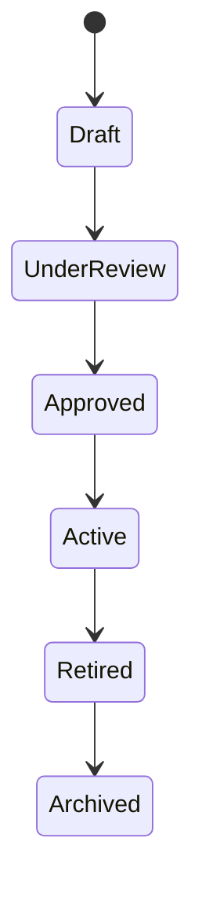
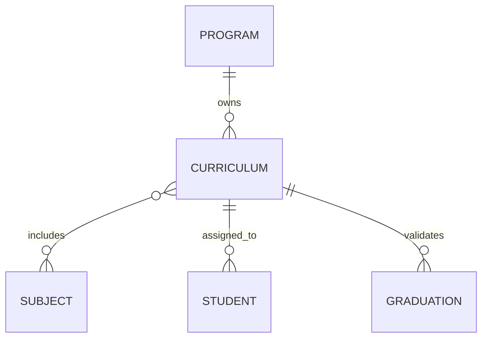

# Nexus School

# Curriculum Specification

---

| Property | Value |
|----------|-------|
| Domain | Academic |
| Module | Academic Management |
| Entity | Curriculum |
| Table | curricula |
| Primary Key | UUID |
| Version | 1.0.0 |
| Status | Approved |
| Owner | Nexus Technologies |
| Last Updated | 2026-07-03 |

---

# Table of Contents

1. Purpose
2. Business Definition
3. Business Objectives
4. Scope
5. Dependencies
6. Lifecycle
7. State Machine
8. Core Attributes
9. Relationships
10. Business Rules
11. Validation Rules
12. Permissions
13. Business Events
14. Notifications
15. Audit Requirements
16. API Mapping
17. Filament Resource
18. Database Mapping
19. Planned Eloquent Relationships
20. Versioning Strategy
21. Performance
22. Edge Cases
23. Future Enhancements
24. Related Documents
25. Summary

---

# 1. Purpose

A Curriculum defines the official academic structure of a Program.

It specifies the Subjects, academic progression, credit requirements and graduation rules applicable to a particular version of a Program.

---

# 2. Business Definition

A Curriculum is the official academic plan that students follow.

Examples:

- BTech Cybersecurity Curriculum 2024
- BTech Cybersecurity Curriculum 2026
- Diploma Nursing Curriculum 2025

Each Curriculum belongs to exactly one Program.

A Program may have multiple Curriculum versions.

---

# 3. Business Objectives

The Curriculum provides:

- Academic planning
- Subject organization
- Graduation requirements
- Credit management
- Historical curriculum preservation
- Accreditation support

---

# 4. Scope

Curriculum affects:

- Programs
- Subjects
- Students
- Graduation
- Transcript
- Timetable
- Academic Analytics

---

# 5. Dependencies

## Depends On

- Program
- Subject

## Used By

- Student
- Enrollment
- Graduation
- Transcript
- Timetable
- Examination

---

# 6. Lifecycle

Draft

↓

Under Review

↓

Approved

↓

Active

↓

Retired

↓

Archived

---

# 7. State Machine

---

# 8. Core Attributes

| Attribute | Type | Required |
|------------|------|----------|
| UUID | UUID | Yes |
| Program ID | UUID | Yes |
| Name | String | Yes |
| Version | String | Yes |
| Effective Date | Date | Yes |
| Retirement Date | Date | No |
| Total Credits | Decimal | Yes |
| Graduation Credits | Decimal | Yes |
| Description | Text | No |
| Status | Enum | Yes |
| Created At | Timestamp | Yes |
| Updated At | Timestamp | Yes |
| Deleted At | Timestamp | No |

---

# 9. Relationships

---

# 10. Business Rules

### CUR-001

Every Curriculum belongs to exactly one Program.

### CUR-002

Each Curriculum has a unique Version within the same Program.

### CUR-003

Only one Curriculum Version may be Active for new admissions.

### CUR-004

Students remain linked to the Curriculum Version under which they were admitted unless officially migrated.

### CUR-005

Archived Curricula are immutable.

### CUR-006

Graduation requirements are determined by the assigned Curriculum Version.

---

# 11. Validation Rules

The system validates:

- Existing Program
- Unique Version
- Positive Credit Values
- Effective Date
- Retirement Date
- Valid Status Transition

---

# 12. Permissions

| Permission | Description |
|------------|-------------|
| curriculum.view | View Curricula |
| curriculum.create | Create Curricula |
| curriculum.update | Update Curricula |
| curriculum.delete | Delete Curricula |
| curriculum.activate | Activate Curriculum |
| curriculum.archive | Archive Curriculum |

---

# 13. Business Events

- CurriculumCreated
- CurriculumUpdated
- CurriculumApproved
- CurriculumActivated
- CurriculumRetired
- CurriculumArchived

---

# 14. Notifications

Notifications may be generated when:

- A Curriculum is approved.
- A new Curriculum becomes active.
- A Curriculum is retired.
- Students are migrated to another Curriculum.

---

# 15. Audit Requirements

Every change stores:

- User
- Timestamp
- Tenant
- Previous Values
- New Values
- IP Address
- Device Information

---

# 16. API Mapping

| Method | Endpoint |
|---------|----------|
| GET | /api/v1/curricula |
| GET | /api/v1/curricula/{id} |
| POST | /api/v1/curricula |
| PUT | /api/v1/curricula/{id} |
| DELETE | /api/v1/curricula/{id} |
| POST | /api/v1/curricula/{id}/approve |
| POST | /api/v1/curricula/{id}/activate |

---

# 17. Filament Resource

Supports:

- List
- View
- Create
- Edit
- Version Management
- Subject Assignment
- Approval Workflow
- Archive

---

# 18. Database Mapping

Primary Table

curricula

Indexes

- program_id
- version
- status
- effective_date

Foreign Keys

- program_id → programs.id

A pivot table (`curriculum_subject`) links Curricula and Subjects.

---

# 19. Planned Eloquent Relationships

Curriculum

- belongsTo(Program)
- belongsToMany(Subject)
- hasMany(Student)

---

# 20. Versioning Strategy

Curricula are version-controlled.

Example:

- Curriculum 2024
- Curriculum 2026
- Curriculum 2028

Students always remain attached to the Curriculum Version under which they enrolled unless an authorized migration is performed.

This guarantees transcript integrity and historical accuracy.

---

# 21. Performance

Frequently accessed by:

- Enrollment
- Student Portal
- Graduation Engine
- Transcript Engine

Caching is recommended for Active Curricula.

---

# 22. Edge Cases

Examples include:

- Curriculum revision during an academic year.
- Student migration between Curriculum versions.
- Subject replacement.
- Credit requirement changes.
- Accreditation updates.

---

# 23. Future Enhancements

Possible improvements:

- Accreditation history
- National qualification mapping
- AI curriculum optimization
- Learning outcomes integration
- Competency-based education support

---

# 24. Related Documents

- Program.md
- Subject.md
- Graduation (future domain)
- Transcript (future domain)

---

# 25. Summary

A Curriculum is the authoritative academic blueprint of a Program. It defines the subjects, credit requirements and graduation rules while preserving historical versions for institutional integrity.

---

**End of Document**