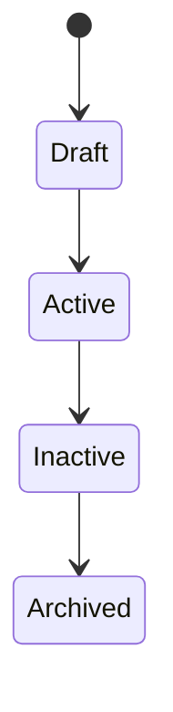
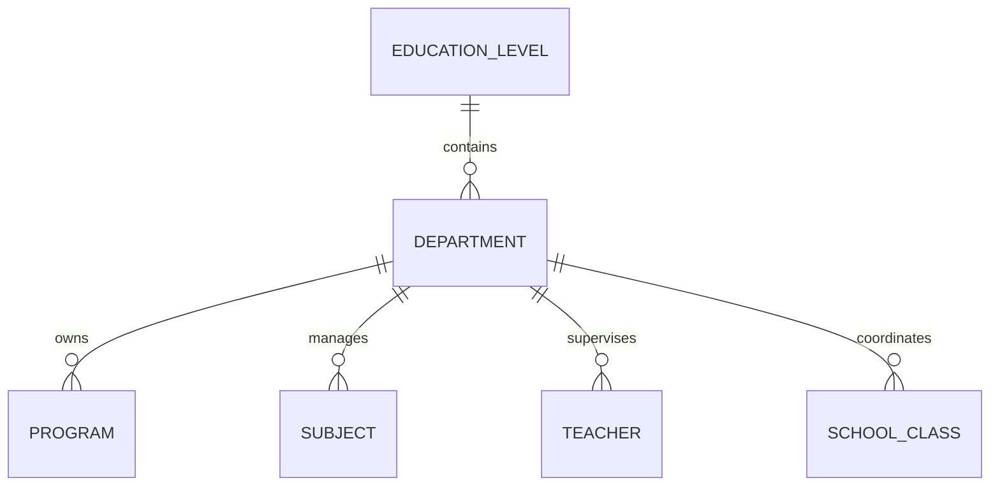

# Nexus School

# Department Specification

---

| Property | Value |
|----------|-------|
| Domain | Academic |
| Module | Academic Management |
| Entity | Department |
| Table | departments |
| Primary Key | UUID |
| Version | 1.0.0 |
| Status | Approved |
| Owner | Nexus Technologies |
| Last Updated | 2026-07-02 |

---

# Table of Contents

1. Purpose
2. Business Definition
3. Business Objectives
4. Scope
5. Dependencies
6. Lifecycle
7. State Machine
8. Core Attributes
9. Relationships
10. Business Rules
11. Validation Rules
12. Permissions
13. Business Events
14. Notifications
15. Audit Requirements
16. API Mapping
17. Filament Resource
18. Database Mapping
19. Planned Eloquent Relationships
20. Performance
21. Edge Cases
22. Future Enhancements
23. Related Documents
24. Summary

---

# 1. Purpose

A Department represents an academic or administrative unit responsible for managing educational programs, academic staff, and institutional resources.

---

# 2. Business Definition

Departments organize academic activities within an Education Level.

Examples include:

- Computer Science
- Mathematics
- Business Administration
- Civil Engineering
- Nursing
- Agriculture
- Humanities

Institutions without departmental structures may use a single default department.

---

# 3. Business Objectives

Departments provide:

- Academic organization
- Faculty management
- Program ownership
- Curriculum governance
- Resource allocation
- Performance reporting

---

# 4. Scope

Departments affect:

- Programs
- Teachers
- Subjects
- School Classes
- Timetables
- Reports
- Analytics

---

# 5. Dependencies

## Depends On

- EducationLevel

## Used By

- Program
- Teacher
- Subject
- Curriculum
- SchoolClass

---

# 6. Lifecycle

Draft

↓

Active

↓

Inactive

↓

Archived

---

# 7. State Machine

---

# 8. Core Attributes

| Attribute | Type | Required |
|------------|------|----------|
| UUID | UUID | Yes |
| Education Level ID | UUID | Yes |
| Name | String | Yes |
| Code | String | Yes |
| Description | Text | No |
| Head Of Department | UUID | No |
| Email | String | No |
| Phone | String | No |
| Office Location | String | No |
| Status | Enum | Yes |
| Display Order | Integer | Yes |
| Created By | UUID | Yes |
| Updated By | UUID | Yes |
| Created At | Timestamp | Yes |
| Updated At | Timestamp | Yes |
| Deleted At | Timestamp | No |

---

# 9. Relationships

---

# 10. Business Rules

### DEP-001

Every Department belongs to one Education Level.

### DEP-002

Department names must be unique within the same Education Level.

### DEP-003

Archived Departments cannot be modified.

### DEP-004

Departments with active Programs cannot be deleted.

### DEP-005

Only active Departments may receive new Programs or Teachers.

---

# 11. Validation Rules

The system validates:

- Unique Name
- Unique Code
- Existing Education Level
- Valid Department Head
- Valid Status

---

# 12. Permissions

| Permission | Description |
|------------|-------------|
| department.view | View Departments |
| department.create | Create Departments |
| department.update | Edit Departments |
| department.delete | Delete Departments |
| department.archive | Archive Departments |

---

# 13. Business Events

- DepartmentCreated
- DepartmentUpdated
- DepartmentArchived
- DepartmentActivated

---

# 14. Notifications

Notifications may be generated when:

- A Department is created.
- A Head of Department is assigned.
- A Department is archived.

---

# 15. Audit Requirements

Every change records:

- User
- Timestamp
- Tenant
- Previous Values
- New Values
- IP Address

---

# 16. API Mapping

| Method | Endpoint |
|---------|----------|
| GET | /api/v1/departments |
| GET | /api/v1/departments/{id} |
| POST | /api/v1/departments |
| PUT | /api/v1/departments/{id} |
| DELETE | /api/v1/departments/{id} |

---

# 17. Filament Resource

Functions include:

- List
- View
- Create
- Edit
- Archive

---

# 18. Database Mapping

Primary Table:

departments

Indexes:

- education_level_id
- code
- status

Foreign Keys:

- education_level_id → education_levels.id
- head_of_department_id → teachers.id (nullable)

---

# 19. Planned Eloquent Relationships

Department

- belongsTo(EducationLevel)
- belongsTo(Teacher, 'head_of_department_id')
- hasMany(Program)
- hasMany(Subject)
- hasMany(SchoolClass)

---

# 20. Performance

Recommended indexes:

- Education Level
- Department Code
- Status

Departments should be cached because they are referenced frequently throughout the academic modules.

---

# 21. Edge Cases

Examples include:

- Removing the Head of Department.
- Merging two Departments.
- Archiving a Department with active Programs.
- Reassigning Teachers during restructuring.

---

# 22. Future Enhancements

Possible improvements:

- Multiple Department Heads.
- Budget management.
- Research groups.
- Department KPIs.
- AI workload balancing.

---

# 23. Related Documents

- EducationLevel.md
- Program.md
- Subject.md
- SchoolClass.md

---

# 24. Summary

Departments organize academic resources, teachers, subjects and programs within an Education Level while serving as the primary organizational unit for academic administration.

---

**End of Document**