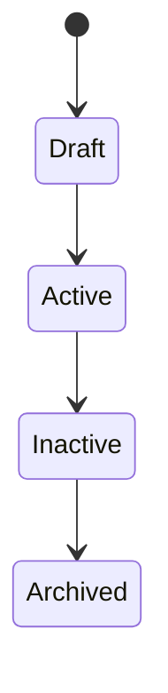
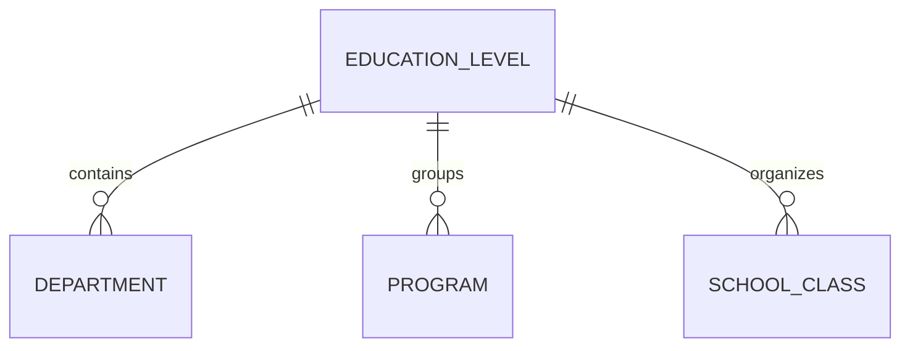

# Nexus School

# Education Level Specification

---

| Property | Value |
|----------|-------|
| Domain | Academic |
| Module | Academic Management |
| Entity | EducationLevel |
| Table | education_levels |
| Primary Key | UUID |
| Version | 1.0.0 |
| Status | Approved |
| Owner | Nexus Technologies |
| Last Updated | 2026-07-02 |

---

# Table of Contents

1. Purpose
2. Business Definition
3. Business Objectives
4. Scope
5. Dependencies
6. Lifecycle
7. State Machine
8. Core Attributes
9. Relationships
10. Business Rules
11. Validation Rules
12. Permissions
13. Business Events
14. Notifications
15. Audit Requirements
16. API Mapping
17. Filament Resource
18. Database Mapping
19. Planned Eloquent Relationships
20. Performance
21. Edge Cases
22. Future Enhancements
23. Related Documents
24. Summary

---

# 1. Purpose

Education Levels define the highest organizational layer of the academic structure.

They classify academic programs according to the educational system adopted by the institution.

---

# 2. Business Definition

An Education Level represents a category of education offered by the institution.

Examples include:

- Primary Education
- Junior High School
- Senior High School
- Technical Education
- Vocational Education
- Undergraduate
- Postgraduate
- Master's Degree
- Doctorate

The system allows institutions to create custom education levels.

---

# 3. Business Objectives

Education Levels provide:

- Academic organization
- Curriculum separation
- Reporting hierarchy
- Student classification
- Program grouping
- Analytics segmentation

---

# 4. Scope

Education Levels affect:

- Departments
- Programs
- School Classes
- Subjects
- Timetables
- Reports
- Admissions
- Graduation

---

# 5. Dependencies

## Used By

- Department
- Program
- SchoolClass
- Curriculum
- Admission
- Student Assignment

---

# 6. Lifecycle

Draft

↓

Active

↓

Inactive

↓

Archived

---

# 7. State Machine

---

# 8. Core Attributes

| Attribute | Type | Required |
|------------|------|----------|
| UUID | UUID | Yes |
| Name | String | Yes |
| Code | String | Yes |
| Description | Text | No |
| Display Order | Integer | Yes |
| Is Default | Boolean | No |
| Status | Enum | Yes |
| Created By | UUID | Yes |
| Updated By | UUID | Yes |
| Created At | Timestamp | Yes |
| Updated At | Timestamp | Yes |
| Deleted At | Timestamp | No |

---

# 9. Relationships

---

# 10. Business Rules

### EL-001

Each Education Level must have a unique name.

### EL-002

Education Levels cannot be deleted if Programs exist.

### EL-003

Archived Education Levels are read-only.

### EL-004

Only active Education Levels can receive new Programs.

### EL-005

Display Order determines presentation order.

---

# 11. Validation Rules

The system validates:

- Unique Name
- Unique Code
- Valid Display Order
- Valid Status
- Existing references before deletion

---

# 12. Permissions

| Permission | Description |
|------------|-------------|
| education_level.view | View Education Levels |
| education_level.create | Create Education Levels |
| education_level.update | Edit Education Levels |
| education_level.delete | Delete Education Levels |
| education_level.archive | Archive Education Levels |

---

# 13. Business Events

- EducationLevelCreated
- EducationLevelUpdated
- EducationLevelActivated
- EducationLevelArchived

---

# 14. Notifications

Notifications may be generated when:

- A new Education Level is created.
- An Education Level is archived.
- Programs are reassigned.

---

# 15. Audit Requirements

Record:

- User
- Timestamp
- Tenant
- Old Values
- New Values
- IP Address

---

# 16. API Mapping

| Method | Endpoint |
|---------|----------|
| GET | /api/v1/education-levels |
| GET | /api/v1/education-levels/{id} |
| POST | /api/v1/education-levels |
| PUT | /api/v1/education-levels/{id} |
| DELETE | /api/v1/education-levels/{id} |

---

# 17. Filament Resource

Features include:

- List
- View
- Create
- Edit
- Archive

---

# 18. Database Mapping

Primary Table:

education_levels

Indexes:

- code
- status
- display_order

---

# 19. Planned Eloquent Relationships

EducationLevel

- hasMany(Department)
- hasMany(Program)
- hasMany(SchoolClass)

---

# 20. Performance

Frequently used records should be cached.

Indexes optimize:

- Search
- Sorting
- Reporting

---

# 21. Edge Cases

Examples include:

- Duplicate names.
- Deleting active Education Levels.
- Changing display order.
- Archived levels referenced by reports.

---

# 22. Future Enhancements

Possible improvements:

- National education templates.
- Ministry curriculum mapping.
- International education frameworks.
- AI curriculum recommendations.

---

# 23. Related Documents

- Department.md
- Program.md
- SchoolClass.md
- Curriculum.md

---

# 24. Summary

Education Levels define the highest academic hierarchy and organize institutional academic offerings into logical educational categories.

---

**End of Document**