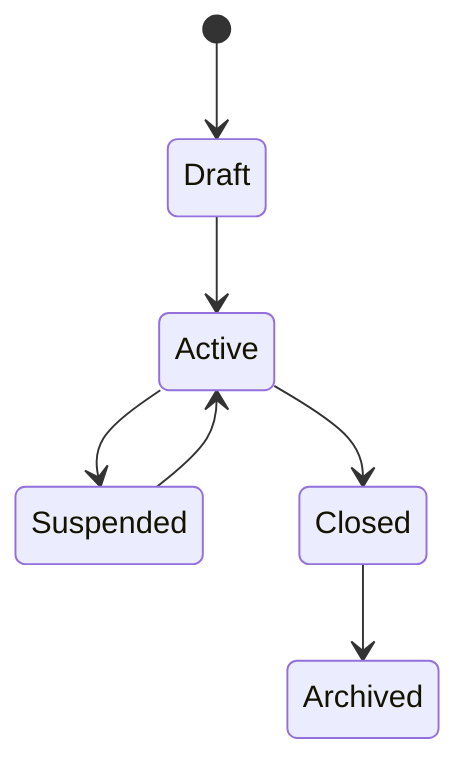
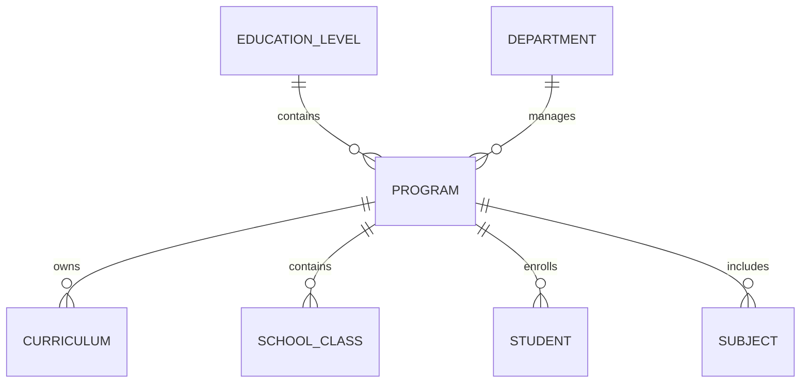

# Nexus School

# Program Specification

---

| Property | Value |
|----------|-------|
| Domain | Academic |
| Module | Academic Management |
| Entity | Program |
| Table | programs |
| Primary Key | UUID |
| Version | 1.0.0 |
| Status | Approved |
| Owner | Nexus Technologies |
| Last Updated | 2026-07-03 |

---

# Table of Contents

1. Purpose
2. Business Definition
3. Business Objectives
4. Scope
5. Dependencies
6. Lifecycle
7. State Machine
8. Core Attributes
9. Relationships
10. Business Rules
11. Validation Rules
12. Permissions
13. Business Events
14. Notifications
15. Audit Requirements
16. API Mapping
17. Filament Resource
18. Database Mapping
19. Planned Eloquent Relationships
20. Performance
21. Edge Cases
22. Future Enhancements
23. Related Documents
24. Summary

---

# 1. Purpose

A Program defines an organized course of study offered by the institution.

It groups students, curriculum, classes, teachers, assessments and graduation requirements into a single academic pathway.

---

# 2. Business Definition

A Program represents an educational offering delivered by the institution.

Examples include:

- BSc Cybersecurity
- BSc Computer Science
- Diploma in Nursing
- Bachelor of Business Administration
- Primary Education
- Junior High School
- Senior High School

Each Program belongs to one Department and one Education Level.

---

# 3. Business Objectives

Programs provide:

- Academic identity
- Student enrollment
- Curriculum management
- Graduation tracking
- Academic reporting
- Degree management

---

# 4. Scope

Programs affect:

- Admissions
- Students
- Curriculum
- Subjects
- School Classes
- Teachers
- Timetables
- Examinations
- Graduation
- Certificates

---

# 5. Dependencies

## Depends On

- EducationLevel
- Department

## Used By

- Student
- Curriculum
- SchoolClass
- Subject
- Timetable
- Graduation
- Transcript
- Certificate

---

# 6. Lifecycle

Draft

↓

Active

↓

Suspended

↓

Closed

↓

Archived

---

# 7. State Machine

---

# 8. Core Attributes

| Attribute | Type | Required |
|------------|------|----------|
| UUID | UUID | Yes |
| Education Level ID | UUID | Yes |
| Department ID | UUID | Yes |
| Name | String | Yes |
| Short Name | String | No |
| Code | String | Yes |
| Description | Text | No |
| Duration | Integer | Yes |
| Duration Unit | Enum | Yes |
| Qualification Awarded | String | Yes |
| Status | Enum | Yes |
| Capacity | Integer | No |
| Display Order | Integer | Yes |
| Created By | UUID | Yes |
| Updated By | UUID | Yes |
| Created At | Timestamp | Yes |
| Updated At | Timestamp | Yes |
| Deleted At | Timestamp | No |

---

# 9. Relationships

---

# 10. Business Rules

### PRG-001

Every Program belongs to one Education Level.

### PRG-002

Every Program belongs to one Department.

### PRG-003

Each Program must have a unique code.

### PRG-004

Only Active Programs accept new student admissions.

### PRG-005

Archived Programs are read-only.

### PRG-006

Programs with enrolled students cannot be deleted.

### PRG-007

A Program must have at least one Curriculum before students can graduate.

### PRG-008

The Qualification Awarded cannot be modified after the first graduating cohort without administrative approval.

---

# 11. Validation Rules

The system validates:

- Unique Program Code
- Unique Program Name within a Department
- Positive Duration
- Existing Department
- Existing Education Level
- Valid Status Transition

---

# 12. Permissions

| Permission | Description |
|------------|-------------|
| program.view | View Programs |
| program.create | Create Programs |
| program.update | Edit Programs |
| program.delete | Delete Programs |
| program.archive | Archive Programs |
| program.activate | Activate Programs |

---

# 13. Business Events

- ProgramCreated
- ProgramUpdated
- ProgramActivated
- ProgramSuspended
- ProgramClosed
- ProgramArchived

---

# 14. Notifications

Notifications may be sent when:

- A Program is created
- A Program is suspended
- A Program is reopened
- A Program reaches capacity

---

# 15. Audit Requirements

Every modification stores:

- User
- Timestamp
- Tenant
- Previous Values
- New Values
- IP Address
- Device Information

---

# 16. API Mapping

| Method | Endpoint |
|---------|----------|
| GET | /api/v1/programs |
| GET | /api/v1/programs/{id} |
| POST | /api/v1/programs |
| PUT | /api/v1/programs/{id} |
| DELETE | /api/v1/programs/{id} |
| POST | /api/v1/programs/{id}/activate |
| POST | /api/v1/programs/{id}/archive |

---

# 17. Filament Resource

The Program Resource supports:

- List
- View
- Create
- Edit
- Archive
- Activate
- Duplicate Program

---

# 18. Database Mapping

Primary Table

programs

Indexes

- education_level_id
- department_id
- code
- status

Foreign Keys

- education_level_id → education_levels.id
- department_id → departments.id

---

# 19. Planned Eloquent Relationships

Program

- belongsTo(EducationLevel)
- belongsTo(Department)
- hasMany(Student)
- hasMany(SchoolClass)
- hasMany(Curriculum)
- belongsToMany(Subject)

---

# 20. Performance

Recommended indexes:

- Program Code
- Department
- Education Level
- Status

Programs should be cached because they are frequently referenced during admissions and reporting.

---

# 21. Edge Cases

Examples include:

- Closing a Program with active students.
- Changing the duration after admissions.
- Merging two Programs.
- Renaming a Program already referenced in transcripts.
- Reopening an archived Program.

---

# 22. Future Enhancements

Potential improvements:

- Double-degree Programs
- International exchange Programs
- Accreditation management
- AI enrollment forecasting
- Curriculum versioning

---

# 23. Related Documents

- EducationLevel.md
- Department.md
- Curriculum.md
- SchoolClass.md
- Student (future domain)

---

# 24. Summary

A Program defines the academic pathway followed by students. It connects organizational structure, curriculum, classes, subjects and graduation requirements into a coherent educational offering.

---

**End of Document**