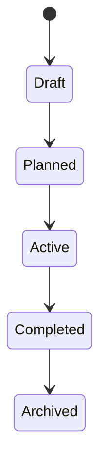
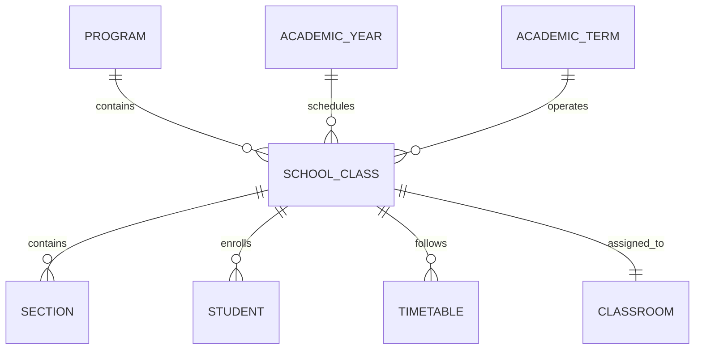

# Nexus School

# School Class Specification

---

| Property | Value |
|----------|-------|
| Domain | Academic |
| Module | Academic Management |
| Entity | SchoolClass |
| Table | school_classes |
| Primary Key | UUID |
| Version | 1.0.0 |
| Status | Approved |
| Owner | Nexus Technologies |
| Last Updated | 2026-07-03 |

---

# Table of Contents

1. Purpose
2. Business Definition
3. Business Objectives
4. Scope
5. Dependencies
6. Lifecycle
7. State Machine
8. Core Attributes
9. Relationships
10. Business Rules
11. Validation Rules
12. Permissions
13. Business Events
14. Notifications
15. Audit Requirements
16. API Mapping
17. Filament Resource
18. Database Mapping
19. Planned Eloquent Relationships
20. Performance
21. Edge Cases
22. Future Enhancements
23. Related Documents
24. Summary

---

# 1. Purpose

A School Class represents a group of students enrolled in the same Program during a specific Academic Year and Academic Term.

It serves as the primary operational unit for teaching, attendance, examinations and scheduling.

---

# 2. Business Definition

A School Class is an instructional group.

Examples:

- BTech Cybersecurity Level 100 - A
- BTech Cybersecurity Level 100 - B
- SHS 2 Science A
- Primary 5 Blue

A School Class may contain one or more Sections.

---

# 3. Business Objectives

School Classes provide:

- Student grouping
- Teacher assignment
- Timetable allocation
- Attendance management
- Examination scheduling
- Classroom allocation

---

# 4. Scope

School Classes affect:

- Students
- Teachers
- Attendance
- Timetable
- Classroom
- Subjects
- Examinations
- Report Cards

---

# 5. Dependencies

## Depends On

- AcademicYear
- AcademicTerm
- Program

## Used By

- Section
- Timetable
- Attendance
- Examination
- Student Enrollment

---

# 6. Lifecycle

Draft

↓

Planned

↓

Active

↓

Completed

↓

Archived

---

# 7. State Machine

---

# 8. Core Attributes

| Attribute | Type | Required |
|------------|------|----------|
| UUID | UUID | Yes |
| Academic Year ID | UUID | Yes |
| Academic Term ID | UUID | Yes |
| Program ID | UUID | Yes |
| Name | String | Yes |
| Code | String | Yes |
| Capacity | Integer | Yes |
| Current Enrollment | Integer | No |
| Homeroom Teacher ID | UUID | No |
| Classroom ID | UUID | No |
| Status | Enum | Yes |
| Created At | Timestamp | Yes |
| Updated At | Timestamp | Yes |
| Deleted At | Timestamp | No |

---

# 9. Relationships

---

# 10. Business Rules

### SC-001

Every School Class belongs to one Program.

### SC-002

Every School Class belongs to one Academic Year.

### SC-003

Every School Class belongs to one Academic Term.

### SC-004

Current Enrollment cannot exceed Capacity.

### SC-005

Archived School Classes are read-only.

### SC-006

Students cannot belong to multiple School Classes within the same Program and Academic Term unless explicitly authorized.

### SC-007

Each School Class may have one Homeroom Teacher.

---

# 11. Validation Rules

The system validates:

- Unique Code
- Capacity greater than zero
- Existing Program
- Existing Academic Year
- Existing Academic Term
- Valid Homeroom Teacher
- Valid Classroom

---

# 12. Permissions

| Permission | Description |
|------------|-------------|
| school_class.view | View School Classes |
| school_class.create | Create School Classes |
| school_class.update | Update School Classes |
| school_class.delete | Delete School Classes |
| school_class.archive | Archive School Classes |
| school_class.assign_teacher | Assign Homeroom Teacher |

---

# 13. Business Events

- SchoolClassCreated
- SchoolClassUpdated
- SchoolClassActivated
- SchoolClassArchived
- HomeroomTeacherAssigned

---

# 14. Notifications

Notifications may be generated when:

- A class reaches maximum capacity.
- A Homeroom Teacher is assigned.
- Students are transferred.
- A class is archived.

---

# 15. Audit Requirements

Audit logs record:

- User
- Timestamp
- Tenant
- Old Values
- New Values
- IP Address
- Device Information

---

# 16. API Mapping

| Method | Endpoint |
|---------|----------|
| GET | /api/v1/school-classes |
| GET | /api/v1/school-classes/{id} |
| POST | /api/v1/school-classes |
| PUT | /api/v1/school-classes/{id} |
| DELETE | /api/v1/school-classes/{id} |

---

# 17. Filament Resource

Supports:

- List
- View
- Create
- Edit
- Archive
- Assign Teacher
- Assign Classroom

---

# 18. Database Mapping

Primary Table

school_classes

Indexes

- academic_year_id
- academic_term_id
- program_id
- classroom_id
- status

---

# 19. Planned Eloquent Relationships

SchoolClass

- belongsTo(AcademicYear)
- belongsTo(AcademicTerm)
- belongsTo(Program)
- belongsTo(Classroom)
- belongsTo(Teacher, 'homeroom_teacher_id')
- hasMany(Section)
- hasMany(Student)
- hasMany(Timetable)

---

# 20. Performance

Frequently queried by:

- Student Portal
- Teacher Portal
- Attendance
- Timetable
- Reports

Recommended caching for active classes.

---

# 21. Edge Cases

Examples include:

- Capacity reached.
- Classroom reassignment during the semester.
- Teacher replacement.
- Student transfer between classes.
- Class cancellation after enrollment.

---

# 22. Future Enhancements

Potential improvements:

- AI-based class balancing.
- Automatic classroom allocation.
- Conflict detection.
- Capacity prediction.
- Smart scheduling.

---

# 23. Related Documents

- Program.md
- AcademicYear.md
- AcademicTerm.md
- Classroom.md
- Section.md
- Timetable.md

---

# 24. Summary

The SchoolClass entity is the operational academic group where teaching activities occur. It connects students, teachers, classrooms, schedules and assessments within a specific Program and Academic period.

---

**End of Document**