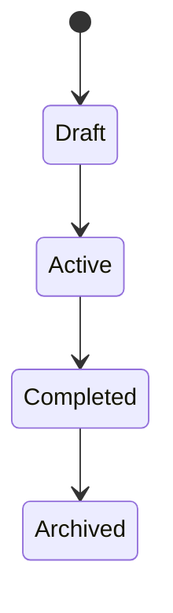
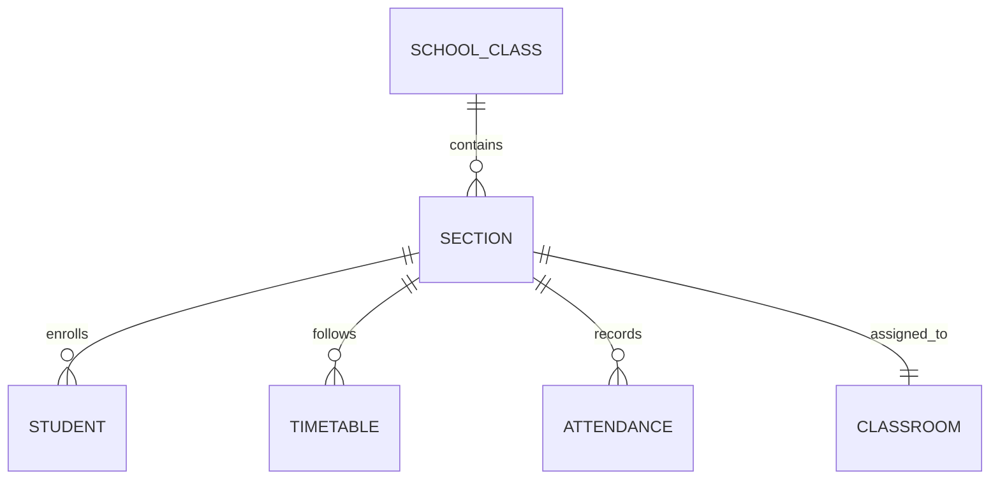

# Nexus School

# Section Specification

---

| Property | Value |
|----------|-------|
| Domain | Academic |
| Module | Academic Management |
| Entity | Section |
| Table | sections |
| Primary Key | UUID |
| Version | 1.0.0 |
| Status | Approved |
| Owner | Nexus Technologies |
| Last Updated | 2026-07-03 |

---

# Table of Contents

1. Purpose
2. Business Definition
3. Business Objectives
4. Scope
5. Dependencies
6. Lifecycle
7. State Machine
8. Core Attributes
9. Relationships
10. Business Rules
11. Validation Rules
12. Permissions
13. Business Events
14. Notifications
15. Audit Requirements
16. API Mapping
17. Filament Resource
18. Database Mapping
19. Planned Eloquent Relationships
20. Performance
21. Edge Cases
22. Future Enhancements
23. Related Documents
24. Summary

---

# 1. Purpose

A Section represents a subdivision of a School Class.

Sections improve academic organization by distributing students into manageable instructional groups while remaining part of the same School Class.

---

# 2. Business Definition

A Section is a subgroup within a School Class.

Examples include:

- Section A
- Section B
- Morning Group
- Afternoon Group
- Laboratory Group
- Practical Group

A School Class may contain zero, one, or many Sections depending on institutional requirements.

---

# 3. Business Objectives

Sections provide:

- Student distribution
- Better classroom management
- Reduced teacher workload
- Flexible scheduling
- Resource optimization

---

# 4. Scope

Sections affect:

- Students
- Teachers
- Timetable
- Attendance
- Classroom Allocation
- Assessments

---

# 5. Dependencies

## Depends On

- SchoolClass

## Used By

- Student
- Timetable
- Attendance
- Examination

---

# 6. Lifecycle

Draft

↓

Active

↓

Completed

↓

Archived

---

# 7. State Machine

---

# 8. Core Attributes

| Attribute | Type | Required |
|------------|------|----------|
| UUID | UUID | Yes |
| School Class ID | UUID | Yes |
| Name | String | Yes |
| Code | String | Yes |
| Capacity | Integer | Yes |
| Current Enrollment | Integer | No |
| Section Leader ID | UUID | No |
| Classroom ID | UUID | No |
| Status | Enum | Yes |
| Display Order | Integer | Yes |
| Created At | Timestamp | Yes |
| Updated At | Timestamp | Yes |
| Deleted At | Timestamp | No |

---

# 9. Relationships

---

# 10. Business Rules

### SEC-001

Every Section belongs to one School Class.

### SEC-002

Section names must be unique within a School Class.

### SEC-003

Current Enrollment cannot exceed Capacity.

### SEC-004

Archived Sections cannot receive new students.

### SEC-005

Students belong to only one Section within the same School Class.

### SEC-006

Sections inherit the Academic Year, Academic Term and Program from their parent School Class.

---

# 11. Validation Rules

The system validates:

- Unique Section Code
- Unique Section Name
- Valid Capacity
- Existing School Class
- Existing Classroom
- Existing Section Leader

---

# 12. Permissions

| Permission | Description |
|------------|-------------|
| section.view | View Sections |
| section.create | Create Sections |
| section.update | Update Sections |
| section.delete | Delete Sections |
| section.archive | Archive Sections |

---

# 13. Business Events

- SectionCreated
- SectionUpdated
- SectionArchived
- StudentAssignedToSection
- StudentRemovedFromSection

---

# 14. Notifications

Notifications may be sent when:

- A Section reaches capacity.
- Students are reassigned.
- A Section is archived.

---

# 15. Audit Requirements

Store:

- User
- Timestamp
- Tenant
- Previous Values
- New Values
- IP Address

---

# 16. API Mapping

| Method | Endpoint |
|---------|----------|
| GET | /api/v1/sections |
| GET | /api/v1/sections/{id} |
| POST | /api/v1/sections |
| PUT | /api/v1/sections/{id} |
| DELETE | /api/v1/sections/{id} |

---

# 17. Filament Resource

Supports:

- List
- View
- Create
- Edit
- Archive
- Student Assignment

---

# 18. Database Mapping

Primary Table

sections

Indexes

- school_class_id
- status
- code

Foreign Keys

- school_class_id → school_classes.id

---

# 19. Planned Eloquent Relationships

Section

- belongsTo(SchoolClass)
- belongsTo(Classroom)
- belongsTo(Teacher, 'section_leader_id')
- hasMany(Student)
- hasMany(Timetable)
- hasMany(Attendance)

---

# 20. Performance

Frequently queried by:

- Attendance
- Timetable
- Teacher Portal
- Student Portal

Indexes and caching are recommended for active Sections.

---

# 21. Edge Cases

Examples include:

- Section reaches capacity.
- Section merged into another.
- Students transferred between Sections.
- Classroom reassignment.
- Section closure during the academic year.

---

# 22. Future Enhancements

Potential improvements:

- AI-powered student balancing.
- Automatic Section creation.
- Smart capacity recommendations.
- Conflict detection.

---

# 23. Related Documents

- SchoolClass.md
- Classroom.md
- Timetable.md
- Student (future domain)

---

# 24. Summary

A Section is an operational subdivision of a School Class that improves scalability, organization and resource allocation while maintaining the academic structure defined by the parent class.

---

**End of Document**