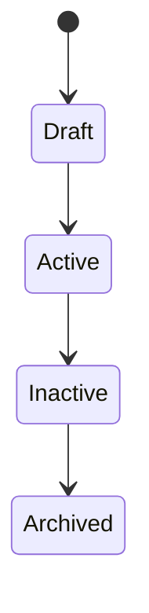
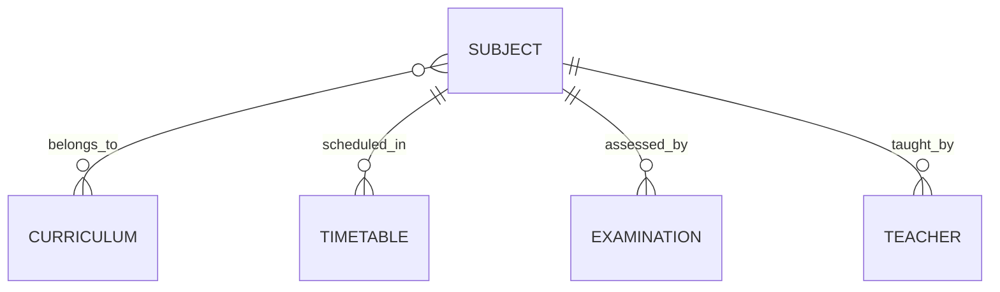

# Nexus School

# Subject Specification

---

| Property | Value |
|----------|-------|
| Domain | Academic |
| Module | Academic Management |
| Entity | Subject |
| Table | subjects |
| Primary Key | UUID |
| Version | 1.0.0 |
| Status | Approved |
| Owner | Nexus Technologies |
| Last Updated | 2026-07-03 |

---

# Table of Contents

1. Purpose
2. Business Definition
3. Business Objectives
4. Scope
5. Dependencies
6. Lifecycle
7. State Machine
8. Core Attributes
9. Relationships
10. Business Rules
11. Validation Rules
12. Permissions
13. Business Events
14. Notifications
15. Audit Requirements
16. API Mapping
17. Filament Resource
18. Database Mapping
19. Planned Eloquent Relationships
20. Performance
21. Edge Cases
22. Future Enhancements
23. Related Documents
24. Summary

---

# 1. Purpose

A Subject represents a teachable academic discipline offered by the institution.

Subjects are reusable academic units that may appear in one or more Curricula.

---

# 2. Business Definition

A Subject defines a unit of instruction delivered to students.

Examples include:

- Mathematics
- English Language
- Physics
- Database Systems
- Network Security
- Operating Systems
- Accounting

A Subject exists independently of any specific Program.

---

# 3. Business Objectives

Subjects provide:

- Standardized course definitions
- Curriculum composition
- Teacher assignment
- Assessment planning
- Academic reporting

---

# 4. Scope

Subjects affect:

- Curriculum
- Teachers
- Timetable
- Attendance
- Examinations
- Grading
- Student Transcripts

---

# 5. Dependencies

## Used By

- Curriculum
- Timetable
- Teacher
- Examination
- Assessment

---

# 6. Lifecycle

Draft

↓

Active

↓

Inactive

↓

Archived

---

# 7. State Machine

---

# 8. Core Attributes

| Attribute | Type | Required |
|------------|------|----------|
| UUID | UUID | Yes |
| Name | String | Yes |
| Code | String | Yes |
| Description | Text | No |
| Credit Hours | Decimal | Yes |
| Theory Hours | Integer | No |
| Practical Hours | Integer | No |
| Subject Type | Enum | Yes |
| Status | Enum | Yes |
| Display Order | Integer | Yes |
| Created At | Timestamp | Yes |
| Updated At | Timestamp | Yes |
| Deleted At | Timestamp | No |

---

# 9. Relationships

---

# 10. Business Rules

### SUB-001

Every Subject has a unique code.

### SUB-002

A Subject may belong to multiple Curricula.

### SUB-003

Archived Subjects cannot be assigned to new Curricula.

### SUB-004

Subjects referenced in historical transcripts cannot be deleted.

### SUB-005

Credit Hours must be greater than zero.

---

# 11. Validation Rules

The system validates:

- Unique Name
- Unique Code
- Positive Credit Hours
- Valid Subject Type
- Valid Status

---

# 12. Permissions

| Permission | Description |
|------------|-------------|
| subject.view | View Subjects |
| subject.create | Create Subjects |
| subject.update | Update Subjects |
| subject.delete | Delete Subjects |
| subject.archive | Archive Subjects |

---

# 13. Business Events

- SubjectCreated
- SubjectUpdated
- SubjectArchived
- SubjectAssignedToCurriculum

---

# 14. Notifications

Notifications may be generated when:

- A new Subject is created.
- A Subject is archived.
- A Subject is added to a Curriculum.

---

# 15. Audit Requirements

Record:

- User
- Timestamp
- Tenant
- Previous Values
- New Values
- IP Address

---

# 16. API Mapping

| Method | Endpoint |
|---------|----------|
| GET | /api/v1/subjects |
| GET | /api/v1/subjects/{id} |
| POST | /api/v1/subjects |
| PUT | /api/v1/subjects/{id} |
| DELETE | /api/v1/subjects/{id} |

---

# 17. Filament Resource

Supports:

- List
- View
- Create
- Edit
- Archive
- Curriculum Assignment

---

# 18. Database Mapping

Primary Table

subjects

Indexes

- code
- status
- subject_type

---

# 19. Planned Eloquent Relationships

Subject

- belongsToMany(Curriculum)
- belongsToMany(Teacher)
- hasMany(Timetable)
- hasMany(Examination)

---

# 20. Performance

Subjects are highly reused and should be cached.

Indexes optimize curriculum generation and timetable scheduling.

---

# 21. Edge Cases

- Subject renamed after transcript generation.
- Subject removed from a Curriculum.
- Credit Hour modification.
- Subject archived while still scheduled.

---

# 22. Future Enhancements

- Subject prerequisites
- Subject equivalencies
- National course catalogs
- AI syllabus generation
- Learning outcomes mapping

---

# 23. Related Documents

- Curriculum.md
- Program.md
- Timetable.md
- Teacher (future domain)

---

# 24. Summary

A Subject is the fundamental academic unit of teaching. It is reusable across multiple curricula and supports scheduling, assessment, grading and transcript generation.

---

**End of Document**