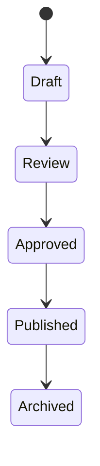
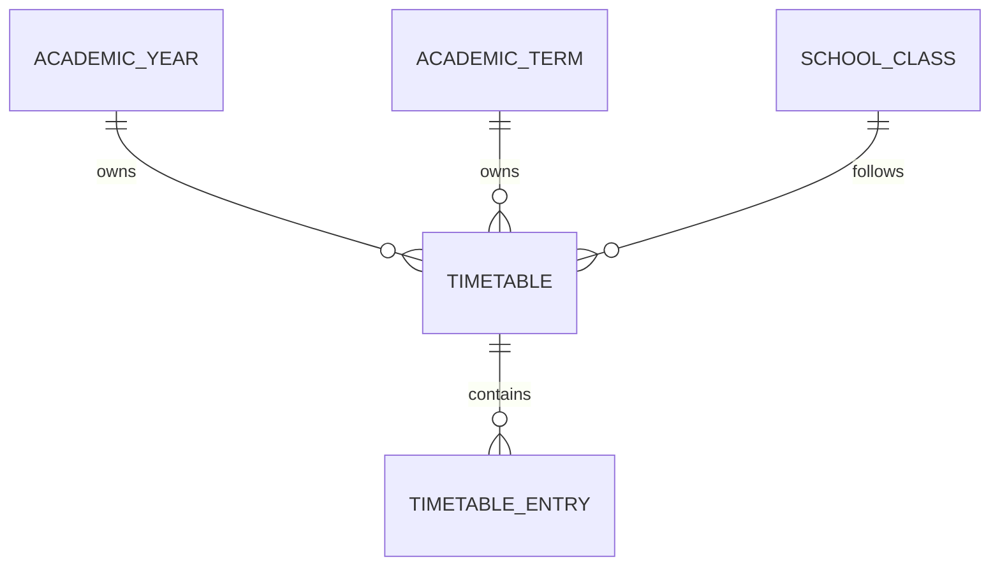

# Nexus School

# Timetable Specification

---

| Property | Value |
|----------|-------|
| Domain | Academic |
| Module | Academic Management |
| Entity | Timetable |
| Table | timetables |
| Primary Key | UUID |
| Version | 1.0.0 |
| Status | Approved |
| Owner | Nexus Technologies |
| Last Updated | 2026-07-03 |

---

# Table of Contents

1. Purpose
2. Business Definition
3. Business Objectives
4. Scope
5. Dependencies
6. Lifecycle
7. State Machine
8. Core Attributes
9. Relationships
10. Business Rules
11. Validation Rules
12. Permissions
13. Business Events
14. Notifications
15. Audit Requirements
16. API Mapping
17. Filament Resource
18. Database Mapping
19. Planned Eloquent Relationships
20. Performance
21. Edge Cases
22. Future Enhancements
23. Related Documents
24. Summary

---

# 1. Purpose

A Timetable represents the official academic schedule assigned to a School Class, Section or Program during a specific Academic Period.

It serves as the master schedule from which individual teaching sessions are generated.

---

# 2. Business Definition

A Timetable is a collection of scheduled teaching activities.

It groups all Timetable Entries that belong to the same academic schedule.

Examples include:

- BTech Cybersecurity Level 100 Semester 1
- SHS 2 Science A
- Primary 6 Weekly Schedule

---

# 3. Business Objectives

Timetables provide:

- Academic scheduling
- Teacher planning
- Classroom allocation
- Student organization
- Conflict prevention
- Resource optimization

---

# 4. Scope

Timetables affect:

- Teachers
- Students
- School Classes
- Sections
- Subjects
- Classrooms
- Attendance
- Examinations

---

# 5. Dependencies

## Depends On

- AcademicYear
- AcademicTerm
- SchoolClass

## Used By

- TimetableEntry
- Attendance
- Teacher Portal
- Student Portal
- Mobile Application

---

# 6. Lifecycle

Draft

↓

Review

↓

Approved

↓

Published

↓

Archived

---

# 7. State Machine

---

# 8. Core Attributes

| Attribute | Type | Required |
|------------|------|----------|
| UUID | UUID | Yes |
| Academic Year ID | UUID | Yes |
| Academic Term ID | UUID | Yes |
| School Class ID | UUID | Yes |
| Name | String | Yes |
| Version | String | Yes |
| Effective Date | Date | Yes |
| Expiration Date | Date | No |
| Status | Enum | Yes |
| Published At | Timestamp | No |
| Created At | Timestamp | Yes |
| Updated At | Timestamp | Yes |
| Deleted At | Timestamp | No |

---

# 9. Relationships

---

# 10. Business Rules

### TT-001

Every Timetable belongs to one Academic Year.

### TT-002

Every Timetable belongs to one Academic Term.

### TT-003

Every Timetable belongs to one School Class.

### TT-004

Only one Published Timetable may exist for the same School Class during the same Academic Term.

### TT-005

Published Timetables become read-only.

### TT-006

A Timetable must contain at least one Timetable Entry before publication.

---

# 11. Validation Rules

The system validates:

- Existing Academic Year
- Existing Academic Term
- Existing School Class
- Unique active timetable
- Valid publication workflow

---

# 12. Permissions

| Permission | Description |
|------------|-------------|
| timetable.view | View Timetables |
| timetable.create | Create Timetables |
| timetable.update | Edit Timetables |
| timetable.publish | Publish Timetables |
| timetable.archive | Archive Timetables |

---

# 13. Business Events

- TimetableCreated
- TimetableUpdated
- TimetablePublished
- TimetableArchived

---

# 14. Notifications

Notifications may be generated when:

- A timetable is published.
- A timetable is updated.
- Students receive schedule changes.
- Teachers receive new assignments.

---

# 15. Audit Requirements

Store:

- User
- Timestamp
- Tenant
- Previous Values
- New Values
- IP Address
- Device Information

---

# 16. API Mapping

| Method | Endpoint |
|---------|----------|
| GET | /api/v1/timetables |
| GET | /api/v1/timetables/{id} |
| POST | /api/v1/timetables |
| PUT | /api/v1/timetables/{id} |
| DELETE | /api/v1/timetables/{id} |
| POST | /api/v1/timetables/{id}/publish |

---

# 17. Filament Resource

Supports:

- List
- View
- Create
- Edit
- Publish
- Duplicate
- Archive

---

# 18. Database Mapping

Primary Table

timetables

Indexes

- academic_year_id
- academic_term_id
- school_class_id
- status

Foreign Keys

- academic_year_id → academic_years.id
- academic_term_id → academic_terms.id
- school_class_id → school_classes.id

---

# 19. Planned Eloquent Relationships

Timetable

- belongsTo(AcademicYear)
- belongsTo(AcademicTerm)
- belongsTo(SchoolClass)
- hasMany(TimetableEntry)

---

# 20. Performance

Frequently accessed by:

- Student Portal
- Teacher Portal
- Mobile App
- Attendance Engine

Published timetables should be cached for fast retrieval.

---

# 21. Edge Cases

Examples include:

- Multiple published timetables.
- Mid-semester timetable changes.
- Emergency schedule replacement.
- Timetable rollback.
- Duplicate schedules.

---

# 22. Future Enhancements

- Timetable versioning
- AI timetable generation
- Automatic conflict detection
- Calendar synchronization (Google Calendar, Outlook)
- Resource optimization engine

---

# 23. Related Documents

- TimetableEntry.md
- Classroom.md
- SchoolClass.md
- Section.md
- Subject.md

---

# 24. Summary

A Timetable is the master academic schedule for a School Class. It organizes instructional activities through Timetable Entries while supporting publication workflows, versioning and future scheduling automation.

---

**End of Document**