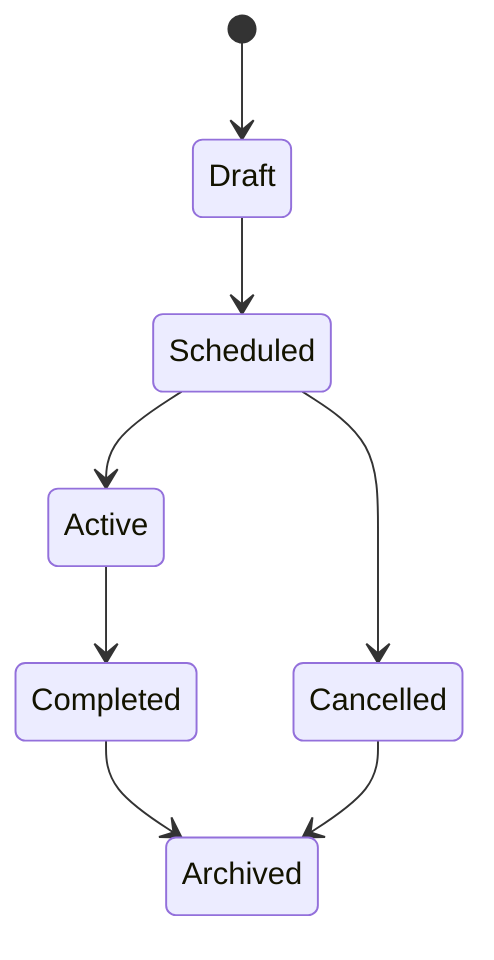
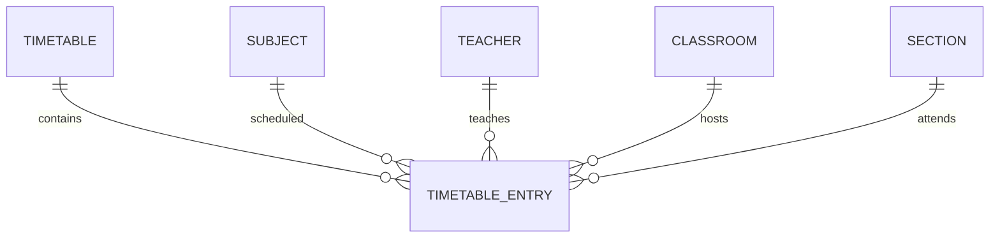

# Nexus School

# Timetable Entry Specification

---

| Property | Value |
|----------|-------|
| Domain | Academic |
| Module | Academic Management |
| Entity | TimetableEntry |
| Table | timetable_entries |
| Primary Key | UUID |
| Version | 1.0.0 |
| Status | Approved |
| Owner | Nexus Technologies |
| Last Updated | 2026-07-03 |

---

# Table of Contents

1. Purpose
2. Business Definition
3. Business Objectives
4. Scope
5. Dependencies
6. Lifecycle
7. State Machine
8. Core Attributes
9. Relationships
10. Business Rules
11. Validation Rules
12. Permissions
13. Business Events
14. Notifications
15. Audit Requirements
16. API Mapping
17. Filament Resource
18. Database Mapping
19. Planned Eloquent Relationships
20. Performance
21. Edge Cases
22. Future Enhancements
23. Related Documents
24. Summary

---

# 1. Purpose

A Timetable Entry represents one scheduled academic activity.

Each entry defines exactly one teaching event occurring at a specific date or recurring time slot.

---

# 2. Business Definition

A Timetable Entry represents an individual lesson or academic activity.

Examples include:

- Database Systems
- Network Security Lab
- Mathematics
- Chemistry Practical
- Examination
- Seminar
- Tutorial

Each entry belongs to one Timetable.

---

# 3. Business Objectives

Timetable Entries provide:

- Daily scheduling
- Teacher assignment
- Subject allocation
- Classroom reservation
- Attendance scheduling
- Examination planning

---

# 4. Scope

Timetable Entries affect:

- Teachers
- Students
- Subjects
- Attendance
- Classroom
- Notifications
- Mobile Calendar

---

# 5. Dependencies

## Depends On

- Timetable
- Subject
- Teacher
- Classroom
- Section (optional)

## Used By

- Attendance
- Teacher Portal
- Student Portal
- Mobile App
- Notification Engine

---

# 6. Lifecycle

Draft

↓

Scheduled

↓

Active

↓

Completed

↓

Cancelled

↓

Archived

---

# 7. State Machine

---

# 8. Core Attributes

| Attribute | Type | Required |
|------------|------|----------|
| UUID | UUID | Yes |
| Timetable ID | UUID | Yes |
| Subject ID | UUID | Yes |
| Teacher ID | UUID | Yes |
| Classroom ID | UUID | Yes |
| Section ID | UUID | No |
| Day Of Week | Enum | Yes |
| Start Time | Time | Yes |
| End Time | Time | Yes |
| Session Type | Enum | Yes |
| Delivery Mode | Enum | Yes |
| Status | Enum | Yes |
| Notes | Text | No |
| Created At | Timestamp | Yes |
| Updated At | Timestamp | Yes |
| Deleted At | Timestamp | No |

---

# 9. Relationships

---

# 10. Business Rules

### TTE-001

Every Timetable Entry belongs to one Timetable.

### TTE-002

A Teacher cannot have two overlapping Timetable Entries.

### TTE-003

A Classroom cannot have overlapping Timetable Entries.

### TTE-004

A Section cannot have overlapping Timetable Entries.

### TTE-005

End Time must always be later than Start Time.

### TTE-006

Cancelled entries remain available for audit purposes.

### TTE-007

Archived entries cannot be modified.

---

# 11. Validation Rules

The system validates:

- Existing Timetable
- Existing Subject
- Existing Teacher
- Existing Classroom
- Time consistency
- Conflict detection
- Valid status transition

---

# 12. Permissions

| Permission | Description |
|------------|-------------|
| timetable_entry.view | View Timetable Entries |
| timetable_entry.create | Create Entries |
| timetable_entry.update | Edit Entries |
| timetable_entry.delete | Delete Entries |
| timetable_entry.cancel | Cancel Entries |

---

# 13. Business Events

- TimetableEntryCreated
- TimetableEntryUpdated
- TimetableEntryCancelled
- TimetableEntryCompleted
- TimetableConflictDetected

---

# 14. Notifications

Notifications may be sent when:

- A lesson is cancelled.
- A teacher changes.
- A classroom changes.
- A lesson starts soon.
- A scheduling conflict is detected.

---

# 15. Audit Requirements

Every modification stores:

- User
- Timestamp
- Tenant
- Previous Values
- New Values
- IP Address
- Device Information

---

# 16. API Mapping

| Method | Endpoint |
|---------|----------|
| GET | /api/v1/timetable-entries |
| GET | /api/v1/timetable-entries/{id} |
| POST | /api/v1/timetable-entries |
| PUT | /api/v1/timetable-entries/{id} |
| DELETE | /api/v1/timetable-entries/{id} |

---

# 17. Filament Resource

Supports:

- List
- View
- Create
- Edit
- Cancel
- Duplicate
- Conflict Checker

---

# 18. Database Mapping

Primary Table

timetable_entries

Indexes

- timetable_id
- teacher_id
- classroom_id
- subject_id
- section_id
- day_of_week
- start_time
- end_time

Foreign Keys

- timetable_id → timetables.id
- subject_id → subjects.id
- teacher_id → teachers.id
- classroom_id → classrooms.id
- section_id → sections.id (nullable)

---

# 19. Planned Eloquent Relationships

TimetableEntry

- belongsTo(Timetable)
- belongsTo(Subject)
- belongsTo(Teacher)
- belongsTo(Classroom)
- belongsTo(Section)

---

# 20. Performance

Frequently accessed by:

- Attendance Engine
- Timetable Engine
- Student Portal
- Teacher Portal
- Mobile Application

Composite indexes are recommended on:

- teacher_id + day_of_week + start_time
- classroom_id + day_of_week + start_time
- section_id + day_of_week + start_time

These indexes significantly improve conflict detection.

---

# 21. Edge Cases

Examples include:

- Teacher double-booked.
- Classroom double-booked.
- Holiday schedule overrides.
- Emergency classroom reassignment.
- Last-minute teacher replacement.
- Online class replacing a physical class.

---

# 22. Future Enhancements

Possible improvements:

- AI timetable optimization.
- Automatic substitute teacher assignment.
- Calendar synchronization.
- QR attendance integration.
- Smart conflict resolution.
- Recurring event templates.

---

# 23. Related Documents

- Timetable.md
- Subject.md
- Classroom.md
- Section.md
- Teacher (future domain)

---

# 24. Summary

A Timetable Entry is the atomic scheduling unit of the academic system. It represents a single teaching activity and coordinates teachers, students, classrooms, subjects and schedules while enforcing conflict-free academic planning.

---

**End of Document**