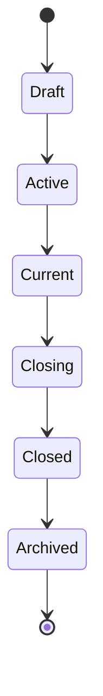

# Academic Year State Machine

## Purpose

This document defines the lifecycle and allowed state transitions of an Academic Year.

The Academic Year controls when academic operations such as enrollments, attendance, grading, examinations, and reporting are permitted.

---

# States

## Draft

The Academic Year is being configured.

Characteristics

- Editable
- Not visible to students
- Enrollment prohibited

---

## Active

Configuration completed.

The Academic Year is ready for enrollment.

Characteristics

- Enrollment allowed
- Academic preparation allowed

---

## Current

Academic activities are in progress.

Characteristics

- Attendance enabled
- Timetable active
- Assessments enabled
- Report cards generated

---

## Closing

Academic activities have ended.

Final processing is taking place.

Examples

- Grade validation
- Ranking calculation
- Report card generation

---

## Closed

Academic Year officially completed.

No further academic modifications allowed.

---

## Archived

Historical state.

Academic Year becomes read-only.

---

# Initial State

Draft

---

# Final State

Archived

---

# Allowed Transitions

Draft

↓

Active

↓

Current

↓

Closing

↓

Closed

↓

Archived

---

# Forbidden Transitions

Archived

↓

Draft

❌

---

Closed

↓

Current

❌

---

Current

↓

Draft

❌

---

Closing

↓

Active

❌

---

# Transition Conditions

Draft → Active

Requirements

- Terms created
- Classrooms configured
- Subjects assigned

---

Active → Current

Requirements

- Enrollment opened
- School officially starts

---

Current → Closing

Requirements

- Academic calendar completed

---

Closing → Closed

Requirements

- Grades finalized
- Report Cards generated

---

Closed → Archived

Requirements

- Administrative approval

---

# Trigger Events

AcademicYearCreated

AcademicYearActivated

AcademicYearStarted

AcademicYearClosing

AcademicYearClosed

AcademicYearArchived

---

# Related Policies

ACA-001

ACA-005

ACA-009

ACA-010

ACA-013

---

# Related Workflows

01_AcademicYearLifecycle

---

# State Diagram

---

# Future Improvements

- Automatic state transitions
- Ministry calendar synchronization
- Scheduled activation
- Scheduled archival