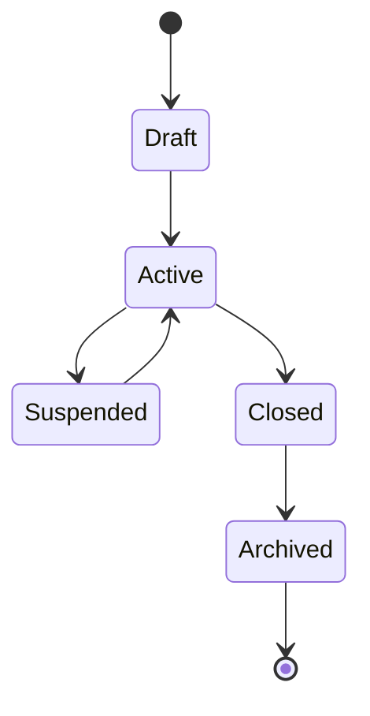

# Class Section State Machine

## Purpose

This document defines the lifecycle and allowed state transitions of a Class Section.

A Class Section represents a subdivision of a Classroom used for academic organization such as laboratory groups, language groups, practical sessions, or administrative sections.

---

# States

## Draft

The Class Section is being configured.

Characteristics

- Editable
- No Students assigned
- Not available for academic activities

---

## Active

The Class Section is operational.

Characteristics

- Students can be assigned
- Attendance enabled
- Timetable enabled
- Practical sessions available

---

## Suspended

The Class Section is temporarily unavailable.

Characteristics

- Existing Students preserved
- No new assignments
- Activities temporarily paused

---

## Closed

The Class Section has completed its academic activities.

Characteristics

- Attendance locked
- Timetable finalized
- No modifications allowed

---

## Archived

Historical state.

Characteristics

- Read-only
- Historical records preserved

---

# Initial State

Draft

---

# Final State

Archived

---

# Allowed Transitions

Draft

↓

Active

↓

Suspended

↓

Active

↓

Closed

↓

Archived

---

# Forbidden Transitions

Archived

↓

Active

❌

---

Closed

↓

Active

❌

---

Draft

↓

Archived

❌

---

Suspended

↓

Draft

❌

---

# Transition Conditions

Draft → Active

Requirements

- Classroom assigned
- Section Name defined
- Capacity defined

---

Active → Suspended

Requirements

- Administrative approval

---

Suspended → Active

Requirements

- Administrative approval

---

Active → Closed

Requirements

- Classroom Closed

---

Closed → Archived

Requirements

- Administrative approval

---

# Trigger Events

ClassSectionCreated

ClassSectionActivated

ClassSectionSuspended

ClassSectionReactivated

ClassSectionClosed

ClassSectionArchived

---

# Related Policies

SEC-001

SEC-003

SEC-005

SEC-009

---

# Related Workflows

09_ClassroomAssignment

10_ClassSectionAssignment

---

# State Diagram

---

# Future Improvements

- Automatic Section Assignment
- AI Section Balancing
- Laboratory Session Management
- Language Group Management
- Dynamic Section Scheduling