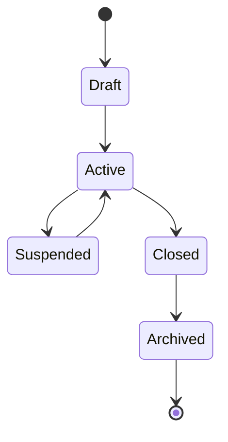

# Classroom State Machine

## Purpose

This document defines the lifecycle and allowed state transitions of a Classroom.

A Classroom represents a group of Students within a specific Academic Year, Program, Level, and optionally a Series.

---

# States

## Draft

The Classroom is being configured.

Characteristics

- Editable
- No Students assigned
- No Timetable
- No Subjects assigned

---

## Active

The Classroom is operational.

Characteristics

- Student enrollment allowed
- Attendance enabled
- Timetable active
- Grade Book active
- Subject assignments available

---

## Suspended

The Classroom is temporarily unavailable.

Characteristics

- Existing Students preserved
- No new assignments
- Academic activities paused

---

## Closed

The Classroom has completed the Academic Year.

Characteristics

- Attendance locked
- Grades finalized
- No modifications allowed

---

## Archived

Historical state.

Characteristics

- Read-only
- Historical reports available
- No academic operations allowed

---

# Initial State

Draft

---

# Final State

Archived

---

# Allowed Transitions

Draft

↓

Active

↓

Suspended

↓

Active

↓

Closed

↓

Archived

---

# Forbidden Transitions

Archived

↓

Active

❌

---

Closed

↓

Active

❌

---

Suspended

↓

Draft

❌

---

Draft

↓

Archived

❌

---

# Transition Conditions

Draft → Active

Requirements

- Academic Year assigned
- Level assigned
- Capacity defined
- Homeroom Teacher assigned (optional)
- Subjects configured

---

Active → Suspended

Requirements

- Administrative approval

---

Suspended → Active

Requirements

- Administrative approval

---

Active → Closed

Requirements

- Academic Year Closed
- Final grades published

---

Closed → Archived

Requirements

- Administrative approval

---

# Trigger Events

ClassroomCreated

ClassroomActivated

ClassroomSuspended

ClassroomReactivated

ClassroomClosed

ClassroomArchived

---

# Related Policies

CLR-001

CLR-003

CLR-006

CLR-009

CLR-012

---

# Related Workflows

01_AcademicYearLifecycle

02_StudentEnrollment

03_StudentPromotion

09_ClassroomAssignment

10_ClassSectionAssignment

---

# State Diagram

---

# Future Improvements

- Automatic Classroom Activation
- AI Capacity Optimization
- Smart Classroom Recommendations
- Multi-Campus Classroom Management
- Classroom Resource Management