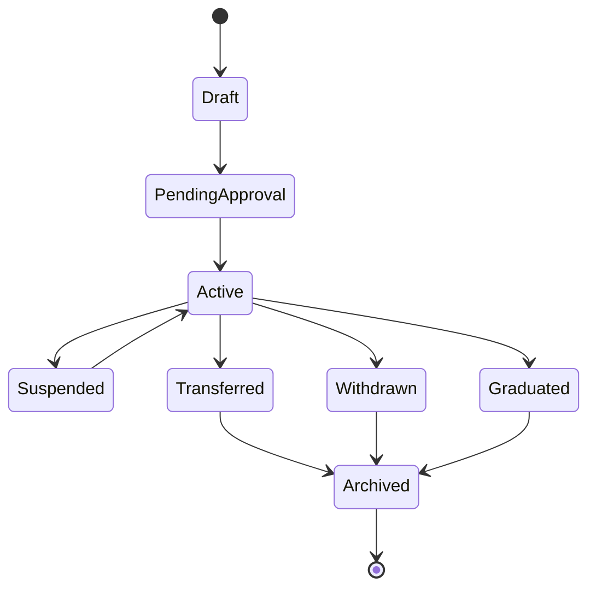

# Enrollment State Machine

## Purpose

This document defines the lifecycle and allowed state transitions of a Student Enrollment.

An Enrollment represents a Student's academic registration within a specific Academic Year, Program, Level, Series, Classroom, and Section.

It is the central entity that connects all academic operations throughout the student's journey.

---

# States

## Draft

The Enrollment is being prepared.

Characteristics

- Editable
- Student not officially registered
- No academic services available

---

## Pending Approval

The Enrollment has been submitted and is awaiting validation.

Characteristics

- Waiting for administrative review
- No attendance
- No timetable
- No grading

---

## Active

The Enrollment is officially active.

Characteristics

- Attendance enabled
- Timetable enabled
- Grade Book enabled
- Assessments enabled
- Student Portal enabled

---

## Suspended

The Enrollment is temporarily suspended.

Characteristics

- Attendance disabled
- Assessments blocked
- Student temporarily inactive
- Historical records preserved

Examples

- Financial suspension
- Administrative suspension
- Disciplinary suspension

---

## Transferred

The Student has transferred to another school or another program.

Characteristics

- Enrollment closed
- Academic records preserved
- Transfer documents generated

---

## Withdrawn

The Student has voluntarily or administratively left the institution.

Characteristics

- Enrollment terminated
- Historical records preserved

---

## Graduated

The Student has successfully completed the Program.

Characteristics

- Graduation recorded
- Transcript generated
- Certificate generated
- Alumni eligibility

---

## Archived

Historical state.

Characteristics

- Read-only
- No further modifications
- Historical reporting only

---

# Initial State

Draft

---

# Final States

Transferred

Withdrawn

Graduated

Archived

---

# Allowed Transitions

Draft

↓

Pending Approval

↓

Active

↓

Suspended

↓

Active

↓

Transferred

↓

Archived

Active

↓

Withdrawn

↓

Archived

Active

↓

Graduated

↓

Archived

---

# Forbidden Transitions

Archived

↓

Active

❌

---

Graduated

↓

Active

❌

---

Withdrawn

↓

Active

❌

---

Transferred

↓

Active

❌

---

Draft

↓

Graduated

❌

---

Pending Approval

↓

Graduated

❌

---

# Transition Conditions

Draft → Pending Approval

Requirements

- Student selected
- Academic Year selected
- Program assigned
- Level assigned

---

Pending Approval → Active

Requirements

- Administrative approval
- Required documents verified
- Initial fees validated (if applicable)

---

Active → Suspended

Requirements

- Administrative decision

Examples

- Financial issue
- Disciplinary action
- Temporary leave

---

Suspended → Active

Requirements

- Suspension lifted

---

Active → Transferred

Requirements

- Approved transfer request

---

Active → Withdrawn

Requirements

- Approved withdrawal request

---

Active → Graduated

Requirements

- Graduation requirements completed
- Final grades published
- Academic Year completed

---

Transferred → Archived

Requirements

- Administrative approval

---

Withdrawn → Archived

Requirements

- Administrative approval

---

Graduated → Archived

Requirements

- Graduation process completed

---

# Trigger Events

EnrollmentCreated

EnrollmentSubmitted

EnrollmentApproved

EnrollmentActivated

EnrollmentSuspended

EnrollmentReactivated

EnrollmentTransferred

EnrollmentWithdrawn

EnrollmentGraduated

EnrollmentArchived

---

# Related Policies

ENR-001

ENR-003

ENR-006

ENR-010

ENR-015

ENR-018

ENR-021

ENR-024

---

# Related Workflows

02_StudentEnrollment

03_StudentPromotion

04_StudentTransfer

05_StudentGraduation

06_StudentWithdrawal

09_ClassroomAssignment

10_ClassSectionAssignment

---

# State Diagram

---

# Future Improvements

- Online Enrollment Approval
- Parent Self-Service Enrollment
- Ministry Enrollment Synchronization
- Automatic Promotion Workflow
- AI Enrollment Validation
- Digital Student File
- Alumni Portal Integration