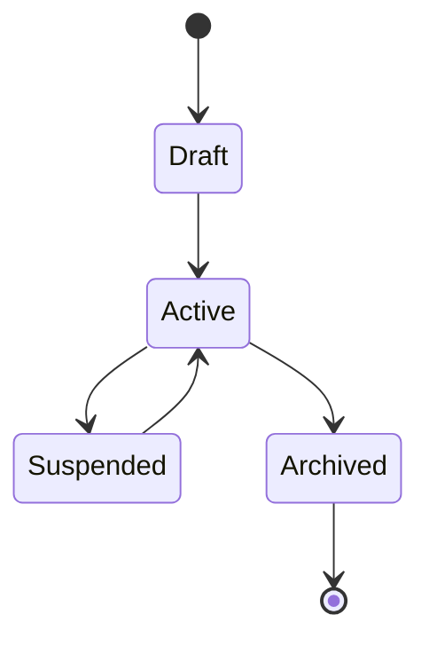

# Level State Machine

## Purpose

This document defines the lifecycle and allowed state transitions of an Academic Level.

An Academic Level represents a stage within an Academic Program and serves as the foundation for Student progression.

Examples

- Grade 6
- Grade 7
- Grade 8
- Grade 9
- Second C
- First D
- Terminal A

---

# States

## Draft

The Level is being configured.

Characteristics

- Editable
- Not available for enrollment
- No Classrooms allowed

---

## Active

The Level is available.

Characteristics

- Enrollment allowed
- Classrooms can be created
- Subjects can be assigned
- Timetables allowed

---

## Suspended

The Level is temporarily unavailable.

Characteristics

- Existing records preserved
- No new enrollments
- Historical records remain available

---

## Archived

Historical state.

Characteristics

- Read-only
- Cannot accept new enrollments
- Used only for historical data

---

# Initial State

Draft

---

# Final State

Archived

---

# Allowed Transitions

Draft

↓

Active

↓

Suspended

↓

Active

↓

Archived

---

# Forbidden Transitions

Archived

↓

Active

❌

---

Archived

↓

Draft

❌

---

Draft

↓

Archived

❌

---

# Transition Conditions

Draft → Active

Requirements

- Program assigned
- Level Name defined
- Level Order defined

---

Active → Suspended

Requirements

- Administrative approval

---

Suspended → Active

Requirements

- Administrative approval

---

Active → Archived

Requirements

- No Active Classrooms
- No Active Enrollments

---

# Trigger Events

LevelCreated

LevelActivated

LevelSuspended

LevelReactivated

LevelArchived

---

# Related Policies

LVL-001

LVL-004

LVL-007

LVL-010

---

# Related Workflows

02_StudentEnrollment

03_StudentPromotion

07_SubjectAssignment

08_SubjectCoefficientManagement

09_ClassroomAssignment

---

# State Diagram

---

# Future Improvements

- Ministry Level Synchronization
- Automatic Promotion Rules
- Multi-Campus Level Management
- Curriculum Version Support