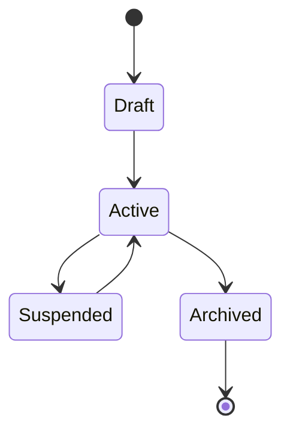

# Program State Machine

## Purpose

This document defines the lifecycle and allowed state transitions of an Academic Program.

An Academic Program represents a structured educational pathway offered by the institution.

Examples

- General Education
- Technical Education
- Vocational Education

---

# States

## Draft

The Program is under creation.

Characteristics

- Editable
- Not available for enrollment
- Not visible in academic operations

---

## Active

The Program is available for use.

Characteristics

- Enrollment allowed
- Levels available
- Classrooms can be created
- Subjects can be assigned

---

## Suspended

The Program is temporarily unavailable.

Characteristics

- Existing records preserved
- No new enrollments
- Historical data remains accessible

---

## Archived

Historical state.

Characteristics

- Read-only
- Cannot be assigned
- Used only for historical records

---

# Initial State

Draft

---

# Final State

Archived

---

# Allowed Transitions

Draft

↓

Active

↓

Suspended

↓

Active

↓

Archived

---

# Forbidden Transitions

Archived

↓

Active

❌

---

Archived

↓

Draft

❌

---

Draft

↓

Archived

❌

---

# Transition Conditions

Draft → Active

Requirements

- Program Name defined
- Program Code defined
- At least one Level exists

---

Active → Suspended

Requirements

- Administrative approval

---

Suspended → Active

Requirements

- Administrative approval

---

Active → Archived

Requirements

- No Active Academic Years using the Program

---

# Trigger Events

ProgramCreated

ProgramActivated

ProgramSuspended

ProgramReactivated

ProgramArchived

---

# Related Policies

PRO-001

PRO-004

PRO-006

PRO-010

---

# Related Workflows

01_AcademicYearLifecycle

02_StudentEnrollment

03_StudentPromotion

---

# State Diagram

---

# Future Improvements

- Ministry Program Synchronization
- Program Versioning
- Multi-Campus Availability
- Automatic Curriculum Assignment