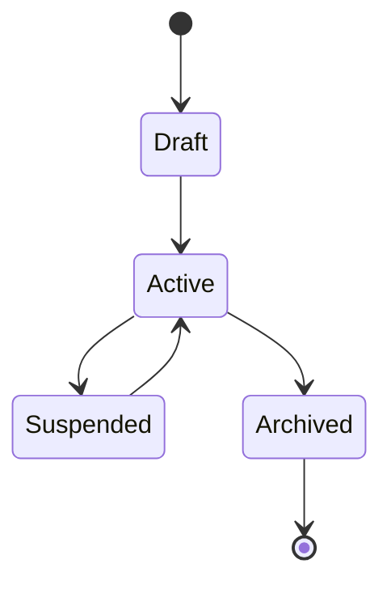

# Series State Machine

## Purpose

This document defines the lifecycle and allowed state transitions of an Academic Series.

An Academic Series represents a specialization within an Academic Program or Level. It determines the curriculum, subject coefficients, assessment rules, and graduation requirements applicable to enrolled Students.

Examples

- Series A
- Series C
- Series D
- Technical Series
- Vocational Series

---

# States

## Draft

The Series is being configured.

Characteristics

- Editable
- Not available for enrollment
- No subject assignment allowed

---

## Active

The Series is operational.

Characteristics

- Enrollment allowed
- Subjects assigned
- Coefficients active
- Timetables allowed
- Assessments enabled

---

## Suspended

The Series is temporarily unavailable.

Characteristics

- Existing Students remain enrolled
- New enrollments prohibited
- Historical data preserved

---

## Archived

Historical state.

Characteristics

- Read-only
- Cannot accept new enrollments
- Available only for historical records

---

# Initial State

Draft

---

# Final State

Archived

---

# Allowed Transitions

Draft

↓

Active

↓

Suspended

↓

Active

↓

Archived

---

# Forbidden Transitions

Archived

↓

Active

❌

---

Archived

↓

Draft

❌

---

Draft

↓

Archived

❌

---

# Transition Conditions

Draft → Active

Requirements

- Program assigned
- Level assigned
- Subject configuration completed
- Subject coefficients configured

---

Active → Suspended

Requirements

- Administrative approval

---

Suspended → Active

Requirements

- Administrative approval

---

Active → Archived

Requirements

- No Active Enrollments
- No Active Classrooms

---

# Trigger Events

SeriesCreated

SeriesActivated

SeriesSuspended

SeriesReactivated

SeriesArchived

---

# Related Policies

SER-001

SER-003

SER-007

SER-010

SER-014

---

# Related Workflows

02_StudentEnrollment

03_StudentPromotion

07_SubjectAssignment

08_SubjectCoefficientManagement

---

# State Diagram

---

# Future Improvements

- Ministry Curriculum Synchronization
- Curriculum Versioning
- Automatic Subject Configuration
- Automatic Coefficient Configuration
- National Education Templates