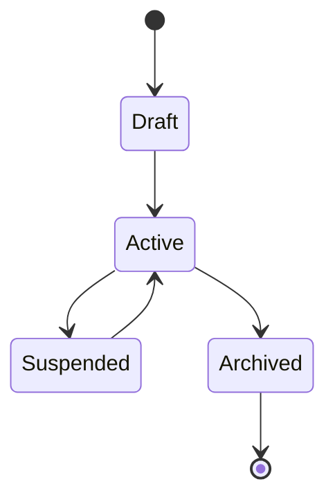

# Subject State Machine

## Purpose

This document defines the lifecycle and allowed state transitions of an Academic Subject.

A Subject represents an academic discipline taught within one or more Academic Programs, Levels, and Series.

Examples

- Mathematics
- French
- English
- Physics
- Chemistry
- Biology
- History & Geography
- Computer Science

---

# States

## Draft

The Subject is being configured.

Characteristics

- Editable
- Not available for assignment
- Hidden from academic operations

---

## Active

The Subject is available.

Characteristics

- Can be assigned to Classrooms
- Can receive coefficients
- Can appear in Timetables
- Can receive Grades

---

## Suspended

The Subject is temporarily unavailable.

Characteristics

- Existing records preserved
- Cannot be assigned to new Classrooms
- Historical Grades remain accessible

---

## Archived

Historical state.

Characteristics

- Read-only
- Used only for historical data
- No future assignments allowed

---

# Initial State

Draft

---

# Final State

Archived

---

# Allowed Transitions

Draft

↓

Active

↓

Suspended

↓

Active

↓

Archived

---

# Forbidden Transitions

Archived

↓

Active

❌

---

Archived

↓

Draft

❌

---

Draft

↓

Archived

❌

---

# Transition Conditions

Draft → Active

Requirements

- Subject Name defined
- Subject Code defined
- Subject Category assigned

---

Active → Suspended

Requirements

- Administrative approval

---

Suspended → Active

Requirements

- Administrative approval

---

Active → Archived

Requirements

- Subject no longer assigned to Active Classrooms

---

# Trigger Events

SubjectCreated

SubjectActivated

SubjectSuspended

SubjectReactivated

SubjectArchived

---

# Related Policies

SUB-001

SUB-003

SUB-006

SUB-010

---

# Related Workflows

07_SubjectAssignment

08_SubjectCoefficientManagement

---

# State Diagram

---

# Future Improvements

- Ministry Subject Catalog Synchronization
- Subject Versioning
- Multi-language Subject Names
- National Curriculum Integration
- AI Subject Classification