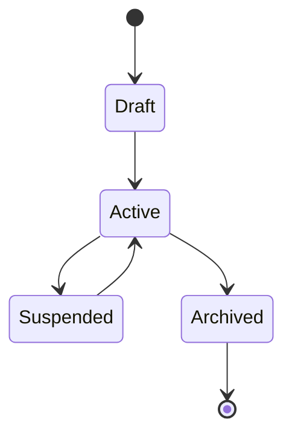

# Subject Coefficient State Machine

## Purpose

This document defines the lifecycle and allowed state transitions of a Subject Coefficient.

A Subject Coefficient determines the academic weight of a Subject within a specific Program, Level, Series, Curriculum, or Academic Year.

Subject Coefficients directly impact grade calculations, student rankings, report cards, and graduation eligibility.

---

# States

## Draft

The Subject Coefficient is being configured.

Characteristics

- Editable
- Not used in grade calculations
- Hidden from academic operations

---

## Active

The Subject Coefficient is officially applied.

Characteristics

- Used in grade calculations
- Used in rankings
- Used in report cards
- Used in graduation calculations

---

## Suspended

The Subject Coefficient is temporarily unavailable.

Characteristics

- Existing historical calculations preserved
- Not used for future academic operations

---

## Archived

Historical state.

Characteristics

- Read-only
- Historical calculations remain valid
- Cannot be assigned again

---

# Initial State

Draft

---

# Final State

Archived

---

# Allowed Transitions

Draft

↓

Active

↓

Suspended

↓

Active

↓

Archived

---

# Forbidden Transitions

Archived

↓

Active

❌

---

Archived

↓

Draft

❌

---

Draft

↓

Archived

❌

---

Suspended

↓

Draft

❌

---

# Transition Conditions

Draft → Active

Requirements

- Subject assigned
- Coefficient value defined
- Program assigned
- Level assigned
- Academic Year assigned

---

Active → Suspended

Requirements

- Administrative approval

---

Suspended → Active

Requirements

- Administrative approval

---

Active → Archived

Requirements

- No Active Academic Period using this configuration

---

# Trigger Events

SubjectCoefficientCreated

SubjectCoefficientActivated

SubjectCoefficientSuspended

SubjectCoefficientReactivated

SubjectCoefficientArchived

---

# Related Policies

COF-001

COF-003

COF-004

COF-009

COF-018

---

# Related Workflows

07_SubjectAssignment

08_SubjectCoefficientManagement

---

# State Diagram

---

# Future Improvements

- Curriculum Versioning
- Ministry Synchronization
- Automatic Coefficient Updates
- Effective Date Support
- Historical Version Comparison