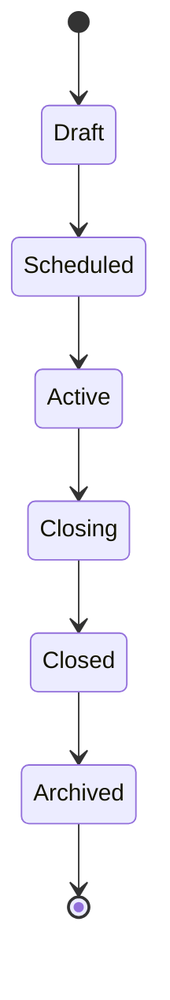

# Term State Machine

## Purpose

This document defines the lifecycle and allowed state transitions of an Academic Term.

A Term controls when teaching, assessments, attendance, grading, and reporting are permitted within a specific period of an Academic Year.

---

# States

## Draft

The Term is being configured.

Characteristics

- Editable
- Not available for academic activities

---

## Scheduled

The Term is configured and waiting for its start date.

Characteristics

- Read-only configuration
- Academic activities not yet allowed

---

## Active

The Term is currently running.

Characteristics

- Attendance enabled
- Assessments enabled
- Grade entry enabled
- Timetable active

---

## Closing

The Term is ending.

Characteristics

- Final assessments
- Grade validation
- Report preparation

---

## Closed

The Term has officially ended.

Characteristics

- Grade entry disabled
- Attendance locked
- Reports finalized

---

## Archived

Historical state.

Characteristics

- Read-only
- Historical reporting available

---

# Initial State

Draft

---

# Final State

Archived

---

# Allowed Transitions

Draft

↓

Scheduled

↓

Active

↓

Closing

↓

Closed

↓

Archived

---

# Forbidden Transitions

Archived

↓

Draft

❌

---

Closed

↓

Active

❌

---

Closing

↓

Scheduled

❌

---

Active

↓

Draft

❌

---

# Transition Conditions

Draft → Scheduled

Requirements

- Start Date defined
- End Date defined
- Academic Year assigned

---

Scheduled → Active

Requirements

- Current date reaches Term start date
- Academic Year is Current

---

Active → Closing

Requirements

- Teaching period completed

---

Closing → Closed

Requirements

- Grades finalized
- Reports generated

---

Closed → Archived

Requirements

- Administrative approval

---

# Trigger Events

TermCreated

TermScheduled

TermStarted

TermClosing

TermClosed

TermArchived

---

# Related Policies

TERM-001

TERM-003

TERM-005

TERM-008

---

# Related Workflows

01_AcademicYearLifecycle

---

# State Diagram

---

# Future Improvements

- Automatic activation based on calendar
- Automatic closing after examinations
- Ministry calendar synchronization
- Scheduled notifications