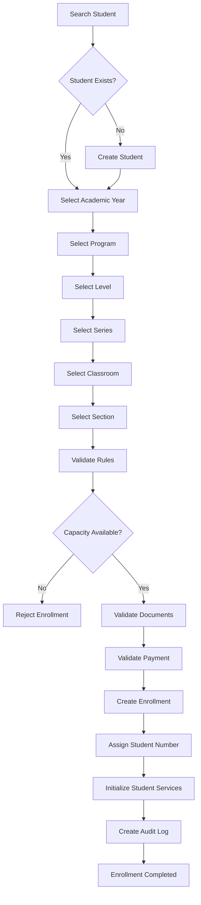

# Student Enrollment Workflow

## Purpose

This workflow describes the complete process of enrolling a Student into an Academic Year.

It ensures that every enrollment follows academic policies, capacity constraints, and validation rules before becoming active.

---

# Actors

- Registrar
- School Administrator
- Finance Officer (optional)
- System

---

# Preconditions

- User is authenticated.
- User has Enrollment permission.
- Academic Year is Active.
- Student exists.
- Classroom exists.

---

# Trigger

User selects:

Academic

↓

Enrollments

↓

New Enrollment

---

# Main Flow

## Step 1

Search or create Student.

If Student does not exist:

Create Student Profile.

---

## Step 2

Select Academic Year.

System verifies:

- Academic Year is Active.

---

## Step 3

Select Program.

---

## Step 4

Select Level.

---

## Step 5

Select Series (optional).

---

## Step 6

Select Classroom.

---

## Step 7

Select Class Section (optional).

---

## Step 8

System validates:

- Classroom belongs to Level.
- Series belongs to Level.
- Section belongs to Classroom.

---

## Step 9

System checks Classroom Capacity.

If Capacity reached

Enrollment rejected.

---

## Step 10

Validate required admission documents.

Examples

- Birth Certificate
- Previous Report Card
- Admission Letter

---

## Step 11

(Optional)

Validate Enrollment Payment.

---

## Step 12

Generate Enrollment Record.

Status

Active

---

## Step 13

Assign Student Number.

If Student already has one

Reuse existing Student Number.

---

## Step 14

Initialize Student Academic Profile.

Examples

- Attendance
- Grades
- Timetable
- Library Access

---

## Step 15

Create Audit Log.

---

## Step 16

Enrollment Completed.

---

# Alternative Flows

## A1

Student already exists.

Skip Student creation.

---

## A2

Payment validation postponed.

Enrollment status

Pending Payment.

---

## A3

Student assigned to another Classroom before confirmation.

Restart Classroom selection.

---

# Exception Flows

## E1

Academic Year not Active.

Enrollment rejected.

---

## E2

Student already enrolled in current Academic Year.

Enrollment rejected.

---

## E3

Classroom Capacity exceeded.

Enrollment rejected.

---

## E4

Required documents missing.

Enrollment saved as Draft.

---

## E5

Database error.

Transaction rolled back.

---

# Postconditions

- Enrollment created.
- Student assigned to Classroom.
- Student appears in attendance.
- Student appears in grading system.
- Student appears in timetable.
- Audit Log recorded.

---

# Related Policies

ENR-001

ENR-003

ENR-004

ENR-006

ENR-009

ENR-015

ENR-019

---

# Future Improvements

- Online Enrollment
- Parent Self-Service Enrollment
- AI Document Verification
- QR Enrollment
- Ministry Student Verification

---

# Workflow Diagram

