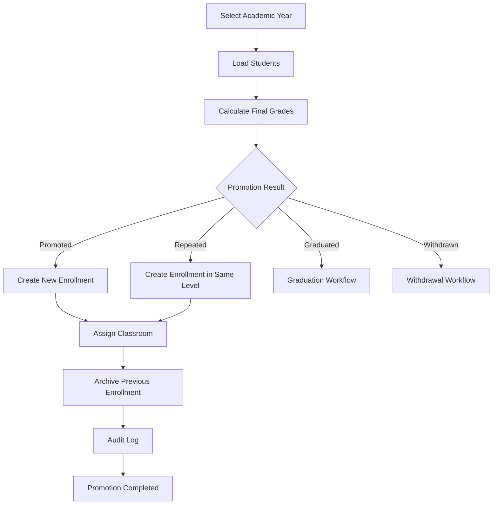

# Student Promotion Workflow

## Purpose

This workflow describes the process of promoting a Student from one academic level to another at the end of an Academic Year.

Promotion creates a new Enrollment while preserving the complete academic history.

---

# Actors

- School Administrator
- Registrar
- Academic Office
- System

---

# Preconditions

- Academic Year is Closed.
- Student has an Active Enrollment.
- Final Grades are published.
- Promotion Rules are available.

---

# Trigger

User selects:

Academic

↓

Promotion

↓

Promote Students

---

# Main Flow

## Step 1

Select Academic Year.

---

## Step 2

Select Program.

---

## Step 3

Select Level or Classroom.

---

## Step 4

System loads eligible Students.

---

## Step 5

System calculates final averages.

---

## Step 6

Determine Promotion Status.

Possible Results

- Promoted
- Repeated
- Graduated
- Withdrawn

---

## Step 7

Administrator reviews promotion list.

---

## Step 8

Administrator validates promotion.

---

## Step 9

System creates a new Enrollment for the next Academic Year.

Historical Enrollment remains unchanged.

---

## Step 10

Assign new:

- Level
- Series (if applicable)
- Classroom
- Class Section (optional)

---

## Step 11

Initialize new academic records.

Examples

- Attendance
- Timetable
- Grade Book

---

## Step 12

Archive previous Enrollment.

---

## Step 13

Create Audit Log.

---

## Step 14

Promotion Completed.

---

# Alternative Flows

## A1

Student repeats the same Level.

A new Enrollment is created in the same Level.

---

## A2

Student changes Series.

Example

Second C

↓

First D

---

## A3

Student transfers to another School before promotion.

Promotion cancelled.

Transfer Workflow starts.

---

# Exception Flows

## E1

Academic Year not Closed.

Promotion rejected.

---

## E2

Final grades missing.

Promotion rejected.

---

## E3

Target Classroom full.

Student remains Pending Assignment.

---

## E4

Promotion rules unavailable.

Promotion cancelled.

---

## E5

Database error.

Transaction rolled back.

---

# Postconditions

- New Enrollment created.
- Previous Enrollment archived.
- Academic History preserved.
- Audit Log created.

---

# Related Policies

ACA-009

ACA-010

ENR-017

ENR-018

CLR-006

---

# Future Improvements

- Automatic Promotion
- AI Promotion Recommendations
- Ministry Promotion Reports
- Bulk Promotion
- Promotion Statistics

---

# Workflow Diagram

