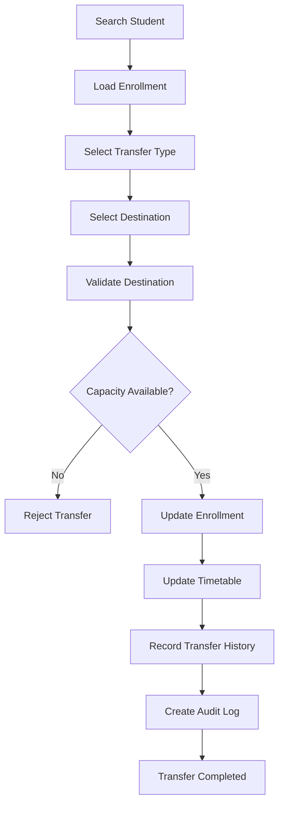

# Student Transfer Workflow

## Purpose

This workflow describes the process of transferring a Student from one Classroom, Level, Series, or School to another while preserving the student's complete academic history.

---

# Actors

- School Administrator
- Registrar
- Academic Office
- System

---

# Preconditions

- Student has an Active Enrollment.
- Destination Classroom exists.
- Destination Classroom is Active.
- Classroom Capacity is available.

---

# Trigger

User selects:

Academic

↓

Transfers

↓

New Transfer

---

# Main Flow

## Step 1

Search Student.

---

## Step 2

Display current Enrollment information.

- Academic Year
- Program
- Level
- Series
- Classroom
- Section

---

## Step 3

Select Transfer Type.

Options

- Classroom Transfer
- Section Transfer
- Series Transfer
- Level Transfer
- School Transfer (Future)

---

## Step 4

Select Destination.

System validates destination.

---

## Step 5

System verifies:

- Capacity available
- Destination active
- Academic compatibility

---

## Step 6

Administrator confirms transfer.

---

## Step 7

System updates Active Enrollment.

Transfer History is recorded.

---

## Step 8

Attendance records continue.

---

## Step 9

Grades remain attached to the same Enrollment.

---

## Step 10

Timetable updated.

---

## Step 11

Audit Log created.

---

## Step 12

Transfer completed.

---

# Alternative Flows

## A1

Transfer to another Classroom.

Only Classroom changes.

---

## A2

Transfer to another Section.

Only Section changes.

---

## A3

Transfer to another Series.

Series and Subjects updated.

---

## A4

Transfer to another School.

Future implementation.

---

# Exception Flows

## E1

Destination Classroom full.

Transfer rejected.

---

## E2

Destination inactive.

Transfer rejected.

---

## E3

Student already transferred.

Duplicate request rejected.

---

## E4

Database error.

Transaction rolled back.

---

# Postconditions

- Student assigned to destination.
- Transfer History updated.
- Timetable updated.
- Audit Log created.

---

# Related Policies

ENR-011

ENR-014

CLR-006

CLR-015

SER-008

---

# Future Improvements

- Inter-school transfers
- Ministry transfer synchronization
- Digital transfer certificates
- Parent transfer requests
- AI classroom balancing

---

# Workflow Diagram

