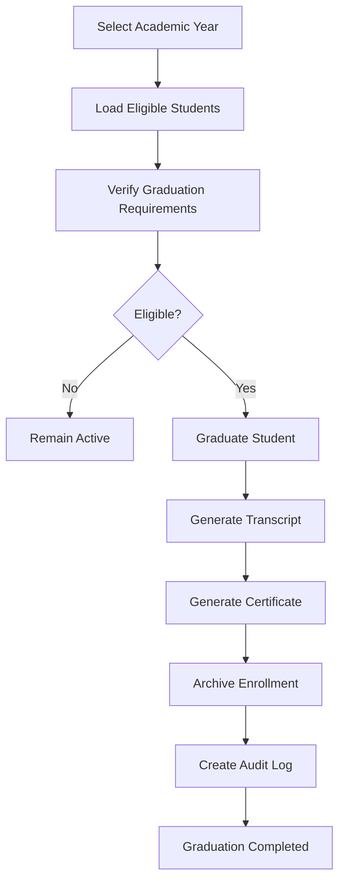

# Student Graduation Workflow

## Purpose

This workflow describes the process of graduating a Student after successfully completing the final Level of an academic Program.

Graduation finalizes the student's academic journey while preserving all historical records.

---

# Actors

- School Administrator
- Registrar
- Academic Office
- Examination Office
- System

---

# Preconditions

- Student has an Active Enrollment.
- Academic Year is Closed.
- Final Grades are published.
- Graduation requirements are satisfied.

---

# Trigger

User selects:

Academic

↓

Graduation

↓

Graduate Students

---

# Main Flow

## Step 1

Select Academic Year.

---

## Step 2

Select Program.

---

## Step 3

Load eligible Students.

---

## Step 4

System verifies graduation requirements.

Examples

- Required Subjects passed
- Required Credits completed
- Final Average achieved

---

## Step 5

Administrator reviews graduation list.

---

## Step 6

Administrator validates graduation.

---

## Step 7

System changes Enrollment Status.

Status

Graduated

---

## Step 8

Generate Graduation Record.

---

## Step 9

Generate Academic Transcript.

---

## Step 10

Generate Graduation Certificate.

(Optional)

---

## Step 11

Archive Enrollment.

---

## Step 12

Create Audit Log.

---

## Step 13

Graduation Completed.

---

# Alternative Flows

## A1

Student qualifies with distinction.

Honor recorded.

---

## A2

Student graduates after supplementary examinations.

---

# Exception Flows

## E1

Graduation requirements not met.

Student not graduated.

---

## E2

Final grades missing.

Graduation rejected.

---

## E3

Academic Year still Active.

Graduation rejected.

---

## E4

Database error.

Transaction rolled back.

---

# Postconditions

- Student status updated.
- Graduation recorded.
- Transcript generated.
- Enrollment archived.
- Audit Log created.

---

# Related Policies

ACA-010

ENR-017

ENR-021

ENR-023

---

# Future Improvements

- Digital Diplomas
- QR Verification
- Ministry Graduation Reporting
- Alumni Registration
- Automatic Alumni Portal Access

---

# Workflow Diagram

