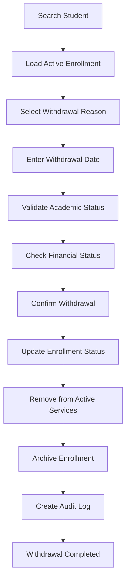

# Student Withdrawal Workflow

## Purpose

This workflow describes the process of withdrawing a Student from the school before completing the current academic Program.

Withdrawal terminates the active Enrollment while preserving all historical academic records.

---

# Actors

- School Administrator
- Registrar
- Finance Officer
- System

---

# Preconditions

- Student has an Active Enrollment.
- User has permission to manage withdrawals.

---

# Trigger

User selects:

Academic

↓

Withdrawals

↓

Withdraw Student

---

# Main Flow

## Step 1

Search Student.

---

## Step 2

Display current Enrollment.

---

## Step 3

Select Withdrawal Reason.

Examples

- Family Relocation
- School Transfer
- Financial Reasons
- Medical Reasons
- Personal Reasons
- Expulsion
- Deceased
- Other

---

## Step 4

Enter Withdrawal Date.

---

## Step 5

(Optional)

Enter additional notes.

---

## Step 6

System validates pending academic activities.

Examples

- Pending Grades
- Pending Attendance
- Active Timetable

---

## Step 7

System checks pending financial obligations.

Examples

- Tuition Balance
- Library Fines
- Transport Fees

---

## Step 8

Administrator confirms Withdrawal.

---

## Step 9

System updates Enrollment Status.

Status

Withdrawn

---

## Step 10

Disable future attendance.

---

## Step 11

Remove Student from active classroom lists.

---

## Step 12

Archive Enrollment.

---

## Step 13

Create Audit Log.

---

## Step 14

Withdrawal Completed.

---

# Alternative Flows

## A1

Student withdraws voluntarily.

---

## A2

Student is withdrawn due to disciplinary action.

---

## A3

Student transfers to another school.

Transfer Workflow may be initiated.

---

# Exception Flows

## E1

Student has no Active Enrollment.

Withdrawal rejected.

---

## E2

Enrollment already Withdrawn.

Duplicate request rejected.

---

## E3

Database error.

Transaction rolled back.

---

# Postconditions

- Enrollment status updated.
- Student removed from active academic activities.
- Historical records preserved.
- Audit Log created.

---

# Related Policies

ENR-015

ENR-016

ENR-021

ENR-022

ENR-024

---

# Future Improvements

- Online Withdrawal Requests
- Parent Self-Service Withdrawal
- Automatic Exit Checklist
- Digital Withdrawal Certificate
- Ministry Withdrawal Reporting

---

# Workflow Diagram

