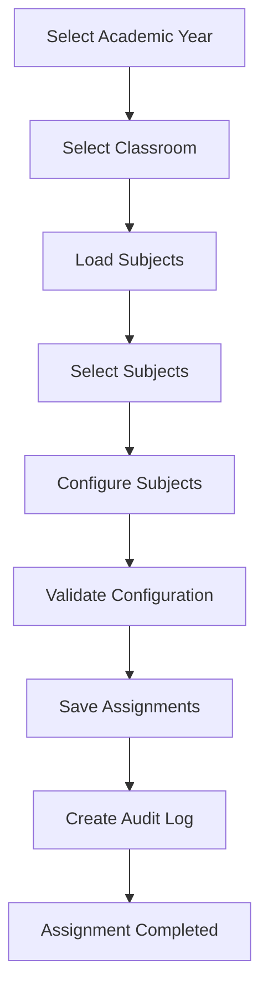

# Subject Assignment Workflow

## Purpose

This workflow describes the process of assigning Subjects to Academic Classrooms.

Subject assignments define which Subjects are taught during an Academic Year and become the foundation for timetables, examinations, grading, and report cards.

---

# Actors

- School Administrator
- Academic Coordinator
- System

---

# Preconditions

- Academic Year is Active.
- Classroom exists.
- Subject exists.
- Subject is Active.

---

# Trigger

User selects:

Academic

↓

Subject Assignments

↓

Assign Subjects

---

# Main Flow

## Step 1

Select Academic Year.

---

## Step 2

Select Program.

---

## Step 3

Select Level.

---

## Step 4

Select Series (optional).

---

## Step 5

Select Classroom.

---

## Step 6

System loads available Subjects.

---

## Step 7

Administrator selects Subjects.

Example

- Mathematics
- French
- English
- History & Geography
- Biology

---

## Step 8

Configure each Subject.

Examples

- Mandatory / Optional
- Weekly Hours
- Display Order

---

## Step 9

Validate Subject configuration.

---

## Step 10

Save Subject Assignments.

---

## Step 11

Create Audit Log.

---

## Step 12

Subject Assignment Completed.

---

# Alternative Flows

## A1

Import Subject Assignments from another Classroom.

---

## A2

Duplicate Subject Assignments from previous Academic Year.

---

## A3

Apply National Curriculum Template.

---

# Exception Flows

## E1

Duplicate Subject detected.

Assignment rejected.

---

## E2

Inactive Subject selected.

Assignment rejected.

---

## E3

Database error.

Transaction rolled back.

---

# Postconditions

- Subjects assigned.
- Classroom configuration updated.
- Audit Log created.

---

# Related Policies

SUB-006

SUB-009

SER-014

SER-015

---

# Future Improvements

- Curriculum Templates
- AI Subject Recommendations
- Ministry Curriculum Import
- Subject Versioning
- Bulk Assignment

---

# Workflow Diagram

