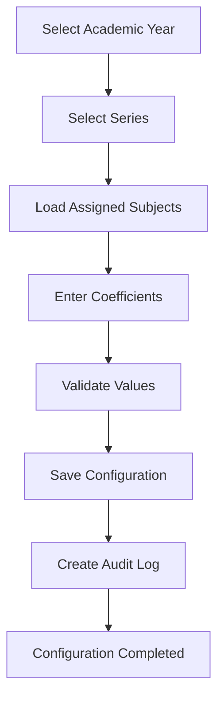

# Subject Coefficient Management Workflow

## Purpose

This workflow describes the process of configuring academic Subject Coefficients for a specific Series or Classroom.

Subject Coefficients determine the academic weight of each Subject in grade calculations, student rankings, report cards, and graduation requirements.

---

# Actors

- School Administrator
- Academic Coordinator
- System

---

# Preconditions

- Academic Year exists.
- Program exists.
- Level exists.
- Series exists.
- Subject Assignments completed.

---

# Trigger

User selects:

Academic

↓

Subject Coefficients

↓

Configure Coefficients

---

# Main Flow

## Step 1

Select Academic Year.

---

## Step 2

Select Program.

---

## Step 3

Select Level.

---

## Step 4

Select Series.

---

## Step 5

System loads assigned Subjects.

---

## Step 6

Administrator enters coefficient for each Subject.

Example

Mathematics → 5

Physics → 4

English → 2

---

## Step 7

System validates coefficients.

Rules

- Greater than zero
- No duplicate Subjects
- Subject must be Active

---

## Step 8

Administrator reviews configuration.

---

## Step 9

Save Subject Coefficients.

---

## Step 10

Create Audit Log.

---

## Step 11

Coefficient Configuration Completed.

---

# Alternative Flows

## A1

Import coefficients from another Series.

---

## A2

Duplicate previous Academic Year configuration.

---

## A3

Apply Ministry Curriculum Template.

---

# Exception Flows

## E1

Invalid coefficient value.

Configuration rejected.

---

## E2

Subject not assigned.

Configuration rejected.

---

## E3

Database error.

Transaction rolled back.

---

# Postconditions

- Subject Coefficients saved.
- Grade calculation updated.
- Report Card configuration updated.
- Audit Log created.

---

# Related Policies

COF-001

COF-003

COF-004

COF-009

COF-018

---

# Future Improvements

- Curriculum Versioning
- National Curriculum Import
- AI Coefficient Suggestions
- Ministry Synchronization
- Bulk Configuration

---

# Workflow Diagram

