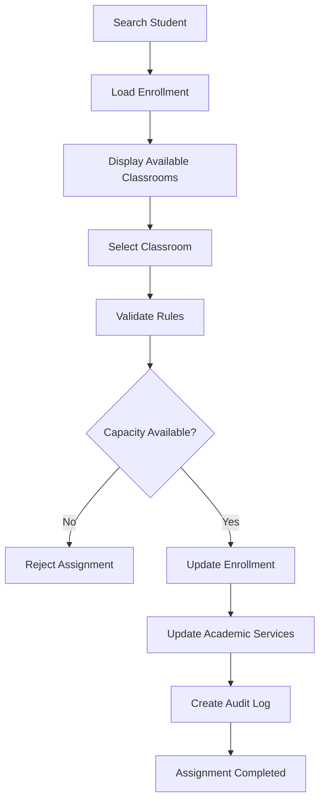

# Classroom Assignment Workflow

## Purpose

This workflow describes the process of assigning Students to Classrooms within an Academic Year.

It ensures that classroom assignments comply with capacity limits, academic structure, and school policies.

---

# Actors

- School Administrator
- Registrar
- Academic Office
- System

---

# Preconditions

- Academic Year is Active.
- Enrollment exists.
- Classroom exists.
- Classroom is Active.

---

# Trigger

User selects:

Academic

↓

Classroom Assignment

↓

Assign Student

---

# Main Flow

## Step 1

Search Student.

---

## Step 2

Load Active Enrollment.

---

## Step 3

Display available Classrooms.

---

## Step 4

Administrator selects Classroom.

---

## Step 5

System validates:

- Classroom belongs to Enrollment Level.
- Classroom belongs to Enrollment Program.
- Series compatibility (if applicable).

---

## Step 6

System checks Classroom Capacity.

---

## Step 7

Administrator confirms assignment.

---

## Step 8

System updates Enrollment.

---

## Step 9

Student appears in:

- Attendance
- Timetable
- Grade Book
- Classroom Roster

---

## Step 10

Create Audit Log.

---

## Step 11

Assignment Completed.

---

# Alternative Flows

## A1

Bulk Classroom Assignment.

Multiple Students assigned simultaneously.

---

## A2

Automatic Classroom Assignment.

System distributes Students according to predefined rules.

---

# Exception Flows

## E1

Classroom Capacity exceeded.

Assignment rejected.

---

## E2

Inactive Classroom.

Assignment rejected.

---

## E3

Enrollment not Active.

Assignment rejected.

---

## E4

Database error.

Transaction rolled back.

---

# Postconditions

- Student assigned.
- Classroom roster updated.
- Attendance initialized.
- Timetable updated.
- Audit Log created.

---

# Related Policies

CLR-005

CLR-006

CLR-010

ENR-006

ENR-009

---

# Future Improvements

- AI Classroom Balancing
- Automatic Classroom Assignment
- Gender Balancing
- Performance-based Distribution
- Classroom Occupancy Analytics

---

# Workflow Diagram

