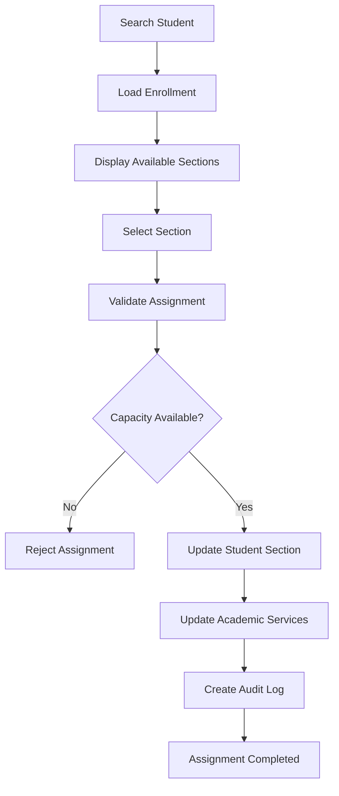

# Class Section Assignment Workflow

## Purpose

This workflow describes the process of assigning Students to Class Sections within an existing Classroom.

Class Sections are used to organize students into smaller groups for academic, laboratory, language, or practical activities.

---

# Actors

- School Administrator
- Registrar
- Academic Coordinator
- System

---

# Preconditions

- Academic Year is Active.
- Student has an Active Enrollment.
- Classroom exists.
- Class Section exists.
- Class Section is Active.

---

# Trigger

User selects:

Academic

↓

Class Section Assignment

↓

Assign Student to Section

---

# Main Flow

## Step 1

Search Student.

---

## Step 2

Load Student Enrollment.

---

## Step 3

Display available Sections for the assigned Classroom.

---

## Step 4

Administrator selects a Section.

---

## Step 5

System validates:

- Section belongs to the Student's Classroom.
- Section is Active.
- Capacity is available.

---

## Step 6

System checks Section Capacity.

---

## Step 7

Administrator confirms assignment.

---

## Step 8

System updates Student Section.

---

## Step 9

Update related academic services.

Examples

- Attendance
- Laboratory Sessions
- Timetable
- Practical Groups

---

## Step 10

Create Audit Log.

---

## Step 11

Assignment Completed.

---

# Alternative Flows

## A1

Bulk Section Assignment.

Assign multiple Students simultaneously.

---

## A2

Automatic Section Distribution.

System distributes Students based on predefined rules.

---

## A3

Manual Section Reassignment.

Student moved from one Section to another.

---

# Exception Flows

## E1

Section Capacity exceeded.

Assignment rejected.

---

## E2

Inactive Section.

Assignment rejected.

---

## E3

Student already assigned to another Section.

Assignment rejected.

---

## E4

Database error.

Transaction rolled back.

---

# Postconditions

- Student assigned to Section.
- Section roster updated.
- Timetable updated.
- Attendance updated.
- Audit Log created.

---

# Related Policies

SEC-005

SEC-006

SEC-007

SEC-010

ENR-015

---

# Future Improvements

- AI Section Balancing
- Laboratory Group Optimization
- Language Group Assignment
- QR Attendance by Section
- Automatic Practical Group Rotation

---

# Workflow Diagram

