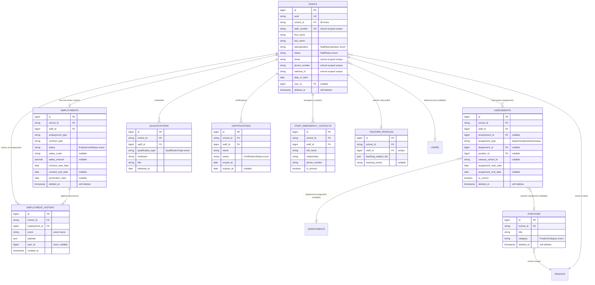

# Staff Domain — Entity Relationship Diagram (SPR-006)

## Purpose

Visualize the 9 tables of the Staff & Workforce domain and their relationships,
including the tenant-isolation and one-active-employment constraints that make
the domain provably correct.

---

## Diagram

---

## Key Constraints

| Constraint | Location | Meaning |
|------------|----------|---------|
| `UNIQUE (school_id, staff_id) WHERE termination_date IS NULL` | `employments` | exactly one active contract per staff per school |
| `UNIQUE (school_id, staff_number)` | `staffs` | staff numbers never re-used (soft-delete only) |
| school-scoped uniqueness | `staffs` (email, phone, national_id) | enforced by actions |
| `school_id` FK → `tenants` on every table | all 9 tables | tenant isolation at database level |
| append-only | `employment_history` | events are inserted, never updated |
| `is_current` | `assignments` | time-aware; actions reject overlaps |

---

## Related Documents

- SPR-006 Staff Engine Report
- [ADR-006](../ADR/ADR-006.md)
- [ERD](ERD.md)
- [Relationships](Relationships.md)
- [MultiTenancy](MultiTenancy.md)
